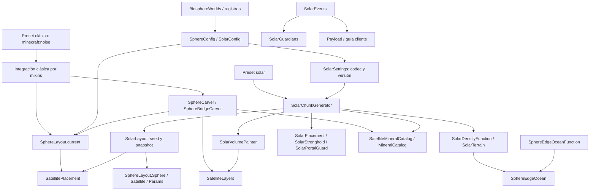

# Auditoría integral de Biospheres

Fecha: 22 de octubre de 2026. Repositorio: `C:\Personal\NeoBiosphere`. Base inspeccionada: `0ed8eae` — `Fit Solar moons below the build ceiling`. Objetivo: Minecraft 1.21.1, NeoForge 21.1.216, Java 21.

**Documento histórico de la fase de diagnóstico, seguido de implementación autorizada.** Las secciones 1–17 describen el commit base y conservan sus evidencias y números de línea; sus afirmaciones de «sin cambios» y «pruebas no ejecutadas» corresponden exclusivamente a aquella fase. El usuario aprobó después la implementación y confirmó que debía preservarse el arreglo de satélites en esferas grandes. El estado vigente de los cambios y las comprobaciones está en la sección 16 de [PLAN_REFACTORIZACION_BIOSPHERES.md](C:/Personal/NeoBiosphere/PLAN_REFACTORIZACION_BIOSPHERES.md).

La implementación posterior corrige retención de acuíferos, coordenadas de heightmaps, validación, cota de densidad, aislamiento de nieve y búsqueda histórica de biomas; comparte materiales de lunas y recupera el ajuste clásico al techo de la rama `1.21.1`. Conserva el algoritmo de colocación, hashes y versiones solares. P7 se autorizó después exclusivamente para mundos clásicos nuevos; su estado está en el plan. Las mediciones de rendimiento y la matriz de mods externos siguen pendientes. El agente no hizo commit ni push ni cambió la versión; las pruebas del motor usan exclusivamente mundos temporales creados para esta tarea dentro de `work/`.

## 1. Resumen ejecutivo

**El proyecto tiene una base mantenible y reutilización real, pero la integración clásica conserva deuda importante de ciclo de vida, validación y contratos con Minecraft.** El solar está más explícitamente separado: posee configuración persistida, distribución propia y componentes para terreno, volumen, estructuras y guardianes. No hay evidencia que justifique una reescritura o un generador universal.

Los cinco problemas prioritarios son:

1. **PERF-001:** un conjunto estático retiene indefinidamente los acuíferos clásicos y, por referencia, sus `NoiseChunk` y cachés.
2. **GEN-001 / COMP-001:** el heightmap clásico consulta satélites con coordenadas locales donde se esperan globales; además, el marcador de chunk no se conserva explícitamente al promover/cargar chunks.
3. **ARCH-001:** la generación clásica depende de configuración global viva; parámetros serializados de densidad/carver no gobiernan la geometría efectiva. La persistencia no fija la receta como sí hace solar.
4. **CFG-001 / CFG-002 / CFG-003:** el catálogo clásico puede publicar pesos totales cero; faltan validaciones numéricas y se validan materiales contra el registro de ítems en vez de bloques.
5. **TEST-001:** hay una inversión considerable en pruebas, pero algunos oráculos prueban réplicas y quedan huecos de integración clásica, versión solar 7, vanilla y compatibilidad real.

La duplicación más relevante es el recorrido/escritura de lunas en `SphereCarver` y `SolarVolumePainter`, no sus distribuciones. Ya comparten colocación, capas, minerales y parte del terreno. Mantener independientes la cuadrícula clásica y las órbitas solares es correcto.

**Resultado de validación:** 15 recursos JSON analizados sintácticamente; tres idiomas con las mismas 89 claves. Se inventariaron 106 métodos JUnit y 20 GameTests. **Ninguno se ejecutó hasta completar resultados durante esta auditoría:** Gradle quedó bloqueado antes de iniciar por acceso denegado al lock de su distribución fuera del proyecto. No se observó un fallo de test y tampoco se acredita un pase. No se inició Minecraft ni se tocaron mundos.

Severidades: alta = fallo de generación, memoria/ciclo de vida o compatibilidad significativa; media = contrato defectuoso o riesgo localizado; baja = mantenimiento sin fallo demostrado. No se identificó una incidencia crítica demostrada. «Confirmado» significa demostrado por código/contrato; no implica reproducción jugable. «Probable» y «requiere verificación» mantienen explícita la incertidumbre.

## 2. Descripción de la arquitectura real

### Alcance y método

Se siguieron reconocimiento, reconstrucción, auditoría, contraste con consumidores/pruebas, diseño y documentación. El inventario contiene 70 archivos Java principales, 7.121 líneas incluyendo infraestructura GameTest, y 13 archivos Java de pruebas: 12 clases de test y un oráculo literal. Se inspeccionaron entradas, configuración, carvers, densidad, geometría, biomas, mixins, eventos, registros, generación de datos, recursos, pruebas y documentación; también cambios históricos relevantes. Los archivos de pruebas y documentación extensos se revisaron por métodos/secciones, sin afirmar lectura exhaustiva de cada línea ni cobertura dinámica.

No se inspeccionaron `build/`, `.gradle/` del proyecto ni `.idea/`. La única excepción de caché fue lectura de fuentes de Minecraft/FML para comprobar contratos; no se extrajeron ni modificaron. No se inspeccionaron partidas ni un servidor en ejecución. No hay resultados de profiler, heap dump, juego, cliente o servidor dedicado. La wiki remota no forma parte del material verificado.

### Localización de evidencia

En las ubicaciones abreviadas del informe, `J/` significa **`C:\Personal\NeoBiosphere\src\main\java\mx\issacinzunza\biosphereworlds\`**, `T/` significa **`C:\Personal\NeoBiosphere\src\test\java\mx\issacinzunza\biosphereworlds\`** y `R/` significa **`C:\Personal\NeoBiosphere\src\main\resources\`**. Los números corresponden al commit base; la auditoría no cambió esas líneas. Los enlaces principales son absolutos.

Fuente Minecraft **MC-S**: `C:\Users\issac\.gradle\caches\neoformruntime\intermediate_results\sourcesWithNeoForge_69ef217555e2d7537686b6c8b26fc1ff01d8487f_output.zip`. Una referencia `MC-S: ruta:línea` identifica el archivo interno de ese ZIP, no una API supuesta.

Fuente FML **FML-S**: `C:\Users\issac\.gradle\caches\modules-2\files-2.1\net.neoforged.fancymodloader\loader\4.0.42\207cf42087abc773f166dc95306edce5f8a538be\loader-4.0.42-sources.jar`. Se contrastaron anotaciones y registro de eventos disponibles en esa caché. La resolución completa del grafo de dependencias de esta ejecución no pudo verificarse por el bloqueo de Gradle.

### Componentes existentes

| Área | Implementación efectiva | Estado y límite |
|---|---|---|
| Entrada | `J/BiosphereWorlds.java:23–36` | Registra configuraciones, tipos, payload y captura del bioma vacío. |
| Clásico | Preset `minecraft:noise`, mixins, `SphereLayout`, dos carvers | Funcionalidad implementada; geometría consultada desde configuración global. |
| Solar | `SolarChunkGenerator`, `SolarSettings`, `SolarLayout` | Generador propio; instantánea serializada y versiones 1–7. |
| Terreno común | Plantilla `noise_settings/biospheres.json`, `SphereEdgeOcean` | Solar moderno adapta funciones y crea su propio `RandomState`. |
| Satélites/lunas | `SatellitePlacement`, `SatelliteLayers`, `MineralCatalog`, `SatelliteMineralCatalog.resolve` | Algoritmos comunes reales; política de fallo y escritura difieren. |
| Biomas | MultiNoise marcado/adaptado; wrappers con codecs históricos | Se preserva acceso directo a MultiNoise para integración. |
| Estructuras | Filtro clásico de comienzos; solar con contención, placement y stronghold central | Semánticas distintas, no intercambiables. |
| Mecánicas | Recuperación de spawn compartida; guardianes y guía solares | Implementadas, con pruebas parciales y comprobaciones jugables pendientes. |
| Integración | Mixins de chunks, acuíferos, heightmaps, biomas, estructuras y spawners | Mayor concentración de riesgo por lifecycle y compatibilidad. |

La entrada y los registros no constituyen un contenedor de servicios ni lo necesitan. Los paquetes actuales `carver`, `density`, `config`, `worldgen`, `worldgen.solar`, `mixin`, `event`, `registry`, `data`, `client` y `gametest` son comprensibles. La dificultad está en descubrir quién marca cada objeto y cuándo, no en la ausencia de más capas.

## 3. Mapa de módulos y dependencias

Las flechas representan dependencias/consumo, no necesariamente llamadas en ese orden. `SolarLayout` usa tipos anidados de `SphereLayout`, pero no `SphereLayout.current()`: existe acoplamiento nominal, **no dependencia de la cuadrícula global clásica en la colocación solar**.

Hay ciclos a nivel de paquetes/tipos: `SphereLayout` consume `SatellitePlacement` y este consume sus records; `config` conoce `SolarSettings`/`SolarLayout` y el código solar conoce configuración; `BiosphereBiomeSourceAccess` expone un tipo concreto solar. No se demostró un ciclo de inicialización que provoque bloqueo. Son obstáculos de separación y pruebas, no prueba de fallo en ejecución (ARCH-002).

## 4. Flujo de generación de mundos

### Clásico

1. `R/data/biosphereworlds/worldgen/world_preset/biospheres.json` selecciona `minecraft:noise`, MultiNoise Overworld y la plantilla propia. No hay una subclase clásica de `ChunkGenerator`.
2. `J/mixin/MixinNoiseBasedChunkGenerator.java:40–70` reconoce el holder de noise settings y excluye primero al generador solar. Marca fuente de biomas, `NoiseChunk`, acuífero y chunk.
3. `J/density/MultipleSpheresDistanceFunction.java:26–39` consulta la esfera de la cuadrícula global y modula densidad; `SphereEdgeOceanFunction` aplica la banda opcional. El mixin de acuíferos devuelve aire fuera del interior admitido.
4. `J/mixin/MixinMultiNoiseBiomeSource.java:25–54` conserva MultiNoise dentro y fuerza `the_void` fuera. Los wrappers antiguos siguen registrados para datos existentes.
5. `J/mixin/MixinChunkGeneratorStructures.java:25–51` filtra el **centro del chunk inicial** con margen, no el volumen de todas las piezas.
6. `MixinNoiseBasedChunkGenerator.applyCarvers:73–135` recorre los biomas/carvers de 17×17 chunks vecinos; ejecuta una vez cada carver propio y cancela el recorrido vanilla si encontró ambos. Un datapack que retire uno cambia esa condición y merece una prueba específica.
7. `J/carver/SphereCarver.java:60–196,209–267` escribe cascarón, cierre superior, liner y satélites. `SphereBridgeCarver:30–142` escribe puentes sin invadir cuerpos.
8. Heightmaps deben ignorar construcciones artificiales según la política; hoy la ruta clásica incumple el contrato de coordenadas de satélites. Vegetación y calles consumen esos mapas.
9. `J/event/PlayerSpawnHandler.java:21–116` recupera jugadores sobre el cascarón buscando soporte y aire; no crea plataformas ni agranda cuerpos.

La cuadrícula usa hash de celda, no la semilla del mundo para el radio. No es por sí mismo un error: es comportamiento histórico a conservar. Semilla, configuración, tags, datapacks y versión del código forman conjuntamente la receta; la semilla sola no basta.

### Solar

1. El preset registra `biosphereworlds:solar_systems`, MultiNoise y la plantilla de ruido compartida. `SolarChunkGenerator.CODEC:55–62` admite snapshot; solo si falta toma configuración al enlazar la semilla.
2. `SolarChunkGenerator.createState:105–154` valida reemplazos del stronghold, crea layout, resuelve minerales si hay lunas, construye estado de ruido propio y publica un `BoundWorld` volátil. Rechaza reusar el generador con otra semilla.
3. `SolarLayout` coloca sistemas y cuerpos con semilla, celdas y versión. Conserva algoritmos históricos; versión 6 introduce órbitas distintas y versión 7 ajusta lunas bajo el techo sin cambiar planetas.
4. `SolarBiomeSource` conserva MultiNoise expuesto, fuerza vacío fuera, adapta temperatura y biomas extremos dentro. No usa configuración clásica viva.
5. `fillFromNoise`, `buildSurface`, `applyCarvers` y decoración (`SolarChunkGenerator:181–211`) combinan motor vanilla, recorte, pintura y reparación del cascarón. Los carvers vanilla se conservan en rutas anteriores a versión 5.
6. `SolarPlacement` identifica chunks centrales sin construir lunas; `SolarStronghold` genera/ajusta piezas, exige portal y contención; `MixinSolarStructureBounds` controla otras estructuras y reemplazos.
7. `SolarPortalGuard` permite escrituras naturales de portal en ámbito acotado mediante `ThreadLocal`, restaurado en `finally`. No pretende bloquear comandos ni toda escritura arbitraria de otros mods.
8. `SolarGuardians` coloca jaulas por chunk y aplica reglas de activación/población; `SolarEvents` restaura marcador de chunks cargados, fija spawn y transmite la guía. Cliente valida dimensión, nivel y caducidad.

Es un mapa de responsabilidades, no una sustitución del grafo de estados de chunks de Minecraft. Las estructuras tienen preparación y colocación en etapas distintas.

## 5. Evaluación SOLID, DRY, KISS y YAGNI

| Principio | Evidencia favorable | Límite / conclusión |
|---|---|---|
| SRP | `SolarLayout` calcula; `SolarVolumePainter` escribe; `SolarPortalGuard` controla permiso; capas minerales son puras. | `SphereLayout.current` mezcla fuente de configuración y geometría; `SatelliteMineralCatalog` mezcla resolución compartida con evento/política clásica. Separación puntual, no división automática por longitud. |
| OCP | Codecs/registries y composición de densidad permiten variar datos sin clonar todo el motor. | Identificación por tipos/holders y rutas concretas en mixins exige revisar fronteras al añadir un generador. Dos implementaciones no justifican un framework de estrategias. |
| LSP | Solar adapta los contratos de `NoiseBasedChunkGenerator` y expone altura/columna propias. | `maxValue()` clásico viola el rango declarado (API-001). `SphereBridgeCarver extends SphereCarver` también sirve para selección con `instanceof`; cambiar herencia rompe despacho, no se ha probado violación funcional por sí sola. |
| ISP | Accesos de chunk/noise son pequeños. | `BiosphereBiomeSourceAccess` agrupa bandera clásica y conexión concreta solar; consumidores conocen más de una política (ARCH-002). |
| DIP | Algoritmos puros reciben datos y no necesitan arrancar NeoForge. | El núcleo clásico consulta directamente `SphereConfig`, y tipos compartidos pertenecen a `SphereLayout`; inversión parcial, no total. |
| DRY | Colocación, estratos, catálogo, océano y búsqueda de spawn compartidos. | Escritura de lunas y normalización de parámetros repetidas. Las versiones antiguas y los oráculos literales no son duplicación a eliminar. |
| KISS | Records, composición directa, cachés acotadas y reglas explícitas. | Marcadores repetidos y registros estáticos de identidad complican lifecycle; la corrección puede simplificarlo. |
| YAGNI | No hay una jerarquía universal de cuerpos ni motor propio de chunks. | `SphereFeature` sin consumidor predeterminado y algunos helpers sin uso merecen inventario/deprecación, no borrado indiscriminado. |

No se calculó complejidad ciclomática con herramienta. Como indicadores de revisión: `SolarGuardians` tiene 342 líneas y varias mecánicas relacionadas; `SolarLayout` combina algoritmos versionados legítimos; `SolarWorldgenGameTests` supera mil líneas, pero es infraestructura excluida del jar. El tamaño no basta para pedir clases nuevas.

## 6. Problemas de modularidad

### ARCH-001 — Receta clásica global y campos serializados sin autoridad

- **Categoría:** Arquitectura. **Severidad:** Alta. **Estado:** Confirmado.
- **Ubicación:** [SphereLayout.java](C:/Personal/NeoBiosphere/src/main/java/mx/issacinzunza/biosphereworlds/worldgen/SphereLayout.java:135), clase `SphereLayout`, `current:135–183`; `J/density/MultipleSpheresDistanceFunction.java`, `CODEC:17–22`, `compute:26–39`; `J/carver/SphereCarver.java`, configuración `346–380` y `carve:65–73`.
- **Evidencia:** `compute` usa `SphereLayout.current()` en vez de sus campos `spacing/radius/centerY`. El carver lee el layout global en vez de usar los parámetros geométricos del codec. `current` vuelve a consultar configuración y sustituye la instantánea cuando detecta cambios.
- **Explicación:** dos fuentes aparentan describir la misma geometría, pero solo la global manda. El codec clásico no fija una receta independiente por mundo.
- **Impacto:** modificar TOML entre sesiones o al recargar puede cambiar chunks nuevos y crear discontinuidades; datapacks pueden serializar valores sin efecto. No se demuestra que una sesión sin cambios de entrada sea no determinista.
- **Solución:** documentar primero la autoridad real; diseñar una captura coherente por mundo y una política explícita para partidas clásicas existentes. No activar de golpe los campos ignorados: sus valores históricos pueden diferir del TOML efectivo.
- **Riesgo de regresión:** Alto. **Esfuerzo:** Alto si se persiste; medio para clarificar/capturar lifecycle.
- **Verificación:** mundo clásico existente, cambio de TOML, reapertura, recarga y chunks contiguos; snapshots de geometría y bloques con entradas idénticas; solar y vanilla sin diferencias.

### ARCH-002 — Frontera compartida dependiente de tipos concretos

- **Categoría:** Arquitectura. **Severidad:** Media. **Estado:** Confirmado.
- **Ubicación:** `J/worldgen/solar/SolarLayout.java`, `moons:359–385`; `J/worldgen/SatellitePlacement.java:51–89`; `J/worldgen/BiosphereBiomeSourceAccess.java`; `J/config/SolarConfig.java:25–43`; `J/worldgen/solar/SolarSettings.java:170–183`.
- **Evidencia:** solar construye `SphereLayout.Params` y `SphereLayout.Sphere`, usando partes del identificador del cuerpo como índices de celda para consumir `SatellitePlacement`; el acceso de biomas expone `SolarBiomeSource`. Configuración y paquete solar se importan mutuamente.
- **Explicación:** los algoritmos comunes son reutilizables, pero su contrato usa vocabulario/propietarios del clásico. No se halló consulta a `SphereLayout.current` en esta colocación solar.
- **Impacto:** cambios en records clásicos o accesos comunes obligan a revisar solar; cuesta distinguir identidad procedural de coordenada real.
- **Solución:** aclarar contratos y adaptar en el borde; extraer únicamente los datos mínimos comunes si una modificación concreta lo necesita. No mover todos los paquetes ni crear una interfaz por clase.
- **Riesgo de regresión:** Medio; alto si cambia la mezcla de identificadores/hash. **Esfuerzo:** Medio.
- **Verificación:** matrices de seeds/versiones y orden de chunks; comparar planetas, lunas e IDs exactamente antes/después, incluidos satélites desactivados.

### GEN-001 — Satélites clásicos consultados con coordenadas locales en heightmaps

- **Categoría:** Compatibilidad. **Severidad:** Alta. **Estado:** Confirmado.
- **Ubicación:** [MixinHeightmap.java](C:/Personal/NeoBiosphere/src/main/java/mx/issacinzunza/biosphereworlds/mixin/MixinHeightmap.java:34), `onUpdateBlockState:34–50`, `onPrimeGetBlockState:73–87`, `solarDownwardRead:58–64`; `J/worldgen/SphereLayout.java`, `isInsideSatellite:335–348`.
- **Evidencia:** llamadas clásicas `isInsideSatellite(x,y,z)` y `isInsideSatellite(pos.getX(),...)` carecen de origen del chunk. Solar sí convierte mediante `solarWorldPosition:91–93`. MC-S `net/minecraft/world/level/levelgen/Heightmap.java:38–72` recorre X/Z 0–15; MC-S `net/minecraft/world/level/chunk/ProtoChunk.java:125–160` llama `update` con `sectionRelative`. La búsqueda descendente de `update` solo se filtra para solar.
- **Explicación:** el predicado de layout espera coordenadas de mundo. Leer una columna local no identifica el satélite real sobre ese chunk; el material de cascarón no cubre piedra, magma ni mineral del interior.
- **Impacto:** altura artificial en mapas que consumen vegetación y calles; también puede ignorarse un volumen equivocado. El defecto de coordenadas está probado; la manifestación visual exacta requiere juego.
- **Solución:** normalizar coordenadas en el borde del mixin y aplicar una política clásica coherente a actualización, primado y búsqueda descendente. Mantener separado el predicado solar.
- **Riesgo de regresión:** Medio: altera heightmaps defectuosos y puede afectar decoración nueva. **Esfuerzo:** Medio.
- **Verificación:** GameTests de satélites en chunks alejados del origen, positivos y negativos, todos los materiales, las tres rutas y chunks sin satélites; comparar alturas y bloques vanilla/solar.

### COMP-001 — Marcador clásico no restaurado en promoción y carga

- **Categoría:** Compatibilidad. **Severidad:** Media. **Estado:** Confirmado respecto al lifecycle del campo; efecto jugable requiere verificación.
- **Ubicación:** `J/mixin/MixinChunkAccess.java:8–20`; `J/mixin/MixinNoiseBasedChunkGenerator.java:53–62`; `J/event/SolarEvents.java:37–42`; MC-S `net/minecraft/world/level/chunk/LevelChunk.java:116–151`.
- **Evidencia:** el marcador clásico es un boolean de instancia, se establece en worldgen y no existe una transferencia/restauración clásica equivalente a `SolarEvents.chunkLoaded`. El constructor de `LevelChunk` copia secciones y heightmaps, no campos arbitrarios de mixin; este boolean no es un attachment NeoForge.
- **Explicación:** un objeto nuevo no hereda la marca del `ProtoChunk`. Los mapas copiados pueden seguir correctos hasta una actualización, pero la política de filtrado depende de una marca perdida.
- **Impacto:** generación y actualizaciones posteriores pueden usar políticas distintas; una recarga puede exponer el problema incluso tras corregir GEN-001.
- **Solución:** restaurar la pertenencia desde el generador propietario en transiciones soportadas, antes de necesitar el filtro; comprobar tanto promoción como lectura de disco.
- **Riesgo de regresión:** Medio. **Esfuerzo:** Medio.
- **Verificación:** mismo chunk durante generación, promoción, modificación de columna, descarga y recarga; marcar solo mundos clásicos, nunca por presencia casual de vidrio.

## 7. Código duplicado identificado

### DUP-001 — Doble implementación de escritura de satélites/lunas

- **Categoría:** Duplicación. **Severidad:** Media. **Estado:** Confirmado.
- **Ubicación:** [SphereCarver.java](C:/Personal/NeoBiosphere/src/main/java/mx/issacinzunza/biosphereworlds/carver/SphereCarver.java:209), escritura `209–267`; [SolarVolumePainter.java](C:/Personal/NeoBiosphere/src/main/java/mx/issacinzunza/biosphereworlds/worldgen/solar/SolarVolumePainter.java:129), `paint:129–156`.
- **Evidencia:** ambos recortan límites de luna al chunk, recorren volumen, clasifican capas con `SatelliteLayers`, eligen mineral y escriben piedra/magma/mineral/cascarón. Los algoritmos de colocación y estratos ya están compartidos.
- **Explicación:** una corrección de escritura debe aplicarse dos veces. No todo el `paint` solar es común: incluye terreno, liner, extremos y compatibilidad histórica.
- **Impacto:** riesgo de divergencia de límites, materiales y filtrado. No se ha demostrado que los dos bucles actuales deban producir idénticos bloques para todas las entradas: su aritmética y política exterior difieren.
- **Solución:** tras asegurar oráculos, consolidar solo la escritura común o primero su decisión de material. Mantener adaptación de cuerpos y políticas fuera. No cambiar el orden de operaciones flotantes: el clásico suma cuadrados en otro orden y solar usa `Math.pow`.
- **Riesgo de regresión:** Alto en límites de bloques. **Esfuerzo:** Medio.
- **Verificación:** igualdad bloque por bloque y heightmap por heightmap, bordes de chunks y techo, radios extremos, paletas, minerales y versiones 1–7; ruta desactivada idéntica.

| Similitud | Clasificación | Acción |
|---|---|---|
| Normalización de satélites en `SphereLayout.Params:75–90` y `current:135–183` | Duplicación menor de validación | Un solo cálculo coherente al construir snapshot, sin cambiar clamps históricos inadvertidamente. |
| Cuadrícula clásica y órbitas solares | Especialización necesaria | No fusionar `SphereLayout` y `SolarLayout`. |
| Distancia clásica estricta y `Body.contains` solar inclusivo | Contratos diferentes | No sustituir por una utilidad «universal» que cambie fronteras. |
| Clima clásico y clima solar | Políticas diferentes sobre infraestructura común | Mantener adaptación MultiNoise específica. |
| Settings generales TOML y snapshot solar | Esquema de entrada y persistencia | Duplicación representacional justificada; mapear/validar una vez. |
| Versiones de distribución/guardianes antiguas | Compatibilidad de partidas | Conservar mientras existan snapshots que las referencien. |
| `SphereEdgeOceanLiteral`, `SolarVolumeBaseline`, fórmulas legacy de tests | Oráculos intencionales | No deduplicar contra la producción que deben contrastar. Mejorar independencia donde sea parcial. |
| Constantes de altura/océano | Contrato técnico duplicado | Ver HARD-001; no convertir todo en TOML. |

## 8. Inventario de hardcoding

### CFG-001 — Catálogo clásico inválido y fallback que revierte exclusiones

- **Categoría:** Arquitectura. **Severidad:** Alta. **Estado:** Confirmado.
- **Ubicación:** [SatelliteMineralCatalog.java](C:/Personal/NeoBiosphere/src/main/java/mx/issacinzunza/biosphereworlds/event/SatelliteMineralCatalog.java:75), `rebuild:75–94`; `J/worldgen/SatelliteLayers.java`, selección `110–133`; `T/worldgen/MineralCatalogTest.java:20–26`; `J/worldgen/solar/SolarChunkGenerator.java:123–135`.
- **Evidencia:** clásico solo comprueba `rebuilt.isEmpty()`. Una lista no vacía con todos los pesos cero se publica; selección lanza excepción cuando el total no es positivo. Reproductor por configuración: excluir los ocho minerales vanilla, incluir un bloque válido adicional y asignar peso mod cero. Solar ya valida el total. Si la lista queda vacía, clásico repone toda la lista vanilla, incluidas exclusiones explícitas.
- **Explicación:** la validez de una distribución ponderada no equivale a «lista no vacía»; fallback y prioridad de exclusiones no están alineados.
- **Impacto:** excepción al generar un satélite clásico o resultado contrario a la selección de minerales solicitada.
- **Solución:** validar antes de publicar y definir claramente la política clásica de catálogo inválido. Reutilizar validación pura; no imponer automáticamente el aborto solar a mundos clásicos sin decidir compatibilidad. No resolver catálogo si la función está apagada.
- **Riesgo de regresión:** Medio. **Esfuerzo:** Bajo/medio.
- **Verificación:** vacío, cero, mezcla positiva/cero, tags inexistentes, exclusiones totales, recarga y función apagada; probar el consumidor real, no solo el selector puro.

### CFG-002 — Dominio numérico clásico insuficientemente validado

- **Categoría:** Arquitectura. **Severidad:** Alta. **Estado:** Confirmado.
- **Ubicación:** `J/config/SphereConfig.java:50,58,107–109`; `J/worldgen/SphereLayout.java:64–101,232–240`; `J/density/MultipleSpheresDistanceFunction.java:39`; `J/mixin/MixinNoiseBasedAquifer.java:47–49`.
- **Evidencia:** spacing, radios, centro y ancho de puente se definen sin rangos; `Params` rechaza spacing no positivo, pero no valida íntegramente radios ni relaciones. La densidad divide entre `radius * radius` calculado como `int`. Radio 0 produce denominador cero; 50.000² desborda un entero de 32 bits.
- **Explicación:** la validación llega tarde o no llega, y los consumidores no comparten un dominio garantizado. Que solar valide al construir snapshot no protege la ruta clásica.
- **Impacto:** valores no finitos/negativos de densidad, geometría incoherente o fallos al generar con configuraciones admitidas por el esquema.
- **Solución:** definir rangos y validaciones cruzadas en la frontera; separar límites técnicos de preferencias de diseño. Mantener inputs históricos válidos y el caso de hash `Math.abs(Integer.MIN_VALUE)` sin «arreglos» colaterales.
- **Riesgo de regresión:** Medio/alto para configuraciones extremas existentes. **Esfuerzo:** Medio.
- **Verificación:** mínimo/máximo, cero, negativos, min > max, spacing incompatible y límites de overflow; errores claros al cargar, antes de generar; matriz de configuraciones históricas válidas.

### CFG-003 — Materiales de bloque validados como ítems

- **Categoría:** Compatibilidad. **Severidad:** Media. **Estado:** Confirmado.
- **Ubicación:** `J/config/SphereConfig.java`, `BRIDGE_BLOCK:57`, `SPHERE_BLOCK:110`, `validateItemName:173–174`; `J/carver/SphereCarver.java:338–343`; `J/carver/SphereBridgeCarver.java:44`; `J/worldgen/solar/SolarVolumePainter.java:44–49`.
- **Evidencia:** `BuiltInRegistries.ITEM.containsKey(ResourceLocation.parse(itemName))` valida opciones que después consultan `BLOCK`. Un ítem sin bloque, por ejemplo `minecraft:stick`, supera la primera condición. `parse` puede lanzar excepción por sintaxis mal formada. Solar aplica fallback a vidrio en su resolución, clásico no comparte esa garantía.
- **Explicación:** validación y consumidor aceptan dominios distintos.
- **Impacto:** cascarón/puente que se convierte en aire o diagnóstico de configuración poco claro; bloques legítimos sin ítem pueden rechazarse.
- **Solución:** validar identificador de forma segura y contra registro de bloques; conservar la semántica explícita de lista vacía y distinguir vacío permitido de entrada inválida.
- **Riesgo de regresión:** Medio. **Esfuerzo:** Bajo.
- **Verificación:** bloque normal, bloque sin ítem disponible, ítem sin bloque, ID desconocido, sintaxis inválida y lista vacía; ambos presets.

### HARD-001 — Alturas y nivel del mar ligados a la plantilla

- **Categoría:** Hardcoding. **Severidad:** Baja. **Estado:** Confirmado como acoplamiento; fallo con plantilla actual no demostrado.
- **Ubicación:** `J/density/SphereEdgeOcean.java:23`; `R/data/biosphereworlds/worldgen/noise_settings/biospheres.json:15–16,354`; `J/worldgen/solar/SolarTerrain.java`; `J/worldgen/solar/SolarLayout.java:365`; `J/worldgen/solar/SolarSettings.java:82–89`.
- **Evidencia:** nivel 63 en lógica/JSON, intervalo de generación −64..319 y parámetros adaptados al techo; defaults/legacy de settings conservan centro 64 mientras configuración nueva usa 62. No todos los defaults representan creación de mundos nuevos.
- **Explicación:** son contratos técnicos y de compatibilidad que un datapack o refactor podría desalinear. No hay evidencia de incoherencia del preset predeterminado por el solo hecho de repetir números.
- **Impacto:** cambiar plantilla o «normalizar defaults» sin conocer la versión puede alterar océanos, techo o mundos antiguos.
- **Solución:** documentar autoridad y probar correspondencias; derivar límites de contexto cuando sea seguro y sin cambiar snapshots antiguos. No añadir opciones para constantes matemáticas.
- **Riesgo de regresión:** Alto si se cambian valores históricos; bajo al documentar. **Esfuerzo:** Bajo/medio.
- **Verificación:** plantilla actual, límites superiores/inferiores, codec sin campos opcionales y versiones históricas.

| Valores/reglas | Clasificación solicitada | Decisión |
|---|---|---|
| 16 bloques/chunk; conversión quart; 12 vértices icosaédricos | Constante matemática/técnica | Mantener, con nombres donde aclaren. |
| Sales de hashes, orden de mezclas y selección de radio | Regla propia del algoritmo | Contrato persistente: no cambiar durante limpieza. |
| Radios, spacing, opciones de océano/satélites y materiales | Parámetros de configuración | Ya existen; corregir validación, no duplicar opciones. |
| Pesos vanilla  y densidades minerales de `SatelliteLayers:57–65` | Balance predeterminado | No hay requisito demostrado de externalizar cada peso. |
| Centro solar Y127, central de radio180 y límites170–190 | Regla solar y contrato de estructuras | Mantener centralizada/versionada; no inferir que sea defecto. |
| Stronghold bajo Y48, liner mar63/profundidad5, margen de portal3 | Reglas especializadas | `SolarTerrain` y `SolarPortalGuard` ya proporcionan propietarios claros. |
| Guardianes: 160–240 ticks, local8, sistema24 | Balance de mecánica solar | Mantener en `SolarGuardians`; externalizar solo con necesidad de producto. |
| `BADLANDS`, `ICE_SPIKES`, anillos/climas | Identidad solar | Extensión futura por datos posible, sin catálogo de estrategias anticipado. |
| Tag `EYE_OF_ENDER_LOCATED` y `c:ores_in_ground/stone` | Integración mediante datos | Mejor que enumerar estructuras/minerales de cada mod. |
| Campos climáticos antiguos, `Guardians` legacy | Compatibilidad | No son código muerto solo porque versión7 no los use igual. |

## 9. Auditoría de los distintos generadores

### API-001 — Cota de densidad declarada incorrecta

- **Categoría:** Compatibilidad. **Severidad:** Media. **Estado:** Confirmado.
- **Ubicación:** [MultipleSpheresDistanceFunction.java](C:/Personal/NeoBiosphere/src/main/java/mx/issacinzunza/biosphereworlds/density/MultipleSpheresDistanceFunction.java:26), `compute:26–39`, `maxValue:48–49`.
- **Evidencia:** declara máximo 2. Con spacing500, radio128, centroY62, punto `(250,62,250)`, la fórmula devuelve `(250²+250²)/128² = 7,62939453125`. MC-S `net/minecraft/world/level/levelgen/DensityFunctions.java:272–273,296,304` usa cotas para atajos de MIN/MAX.
- **Explicación:** el motor y otros consumidores pueden confiar en una cota inferior al valor real. La plantilla actual usa `range_choice` para recorte; no se demuestra un fallo visible de esa composición concreta.
- **Impacto:** composición incorrecta con otras funciones/datapacks y optimizaciones basadas en rango.
- **Solución:** declarar una cota válida para el dominio real, después de validar radios; comprobar si debe ser no acotada. No saturar `compute` a 2 porque cambiaría el algoritmo.
- **Riesgo de regresión:** Medio. **Esfuerzo:** Bajo/medio.
- **Verificación:** puntos extremos, rangos, composiciones MIN/MAX y comparación de bloques del preset actual.

### Comparación de contratos

| Pregunta | Clásico | Solar |
|---|---|---|
| Responsabilidad principal | Reinterpretar Overworld con cuadrícula y carvers | Coordinar sistemas/órbitas con volumen y reglas propias |
| Geometría centralizada | Sí, `SphereLayout`; quedan feature legacy y fórmulas de borde especializadas | Sí, `SolarLayout`, con `SolarTerrain` para reglas de material/altura |
| Semilla | Terreno usa seed; radio/celda clásico no depende de ella | Layout y cuerpos sí usan seed |
| Determinismo | Esperable con configuración/tags/código constantes; global vivo limita estabilidad | Snapshot+versión+seed estables; tags/registry siguen siendo entradas externas |
| Fronteras de chunks | Geometría global coherente; fallo confirmado al consumir coordenadas en heightmap | Recorte por chunk y geometría absoluta; no se halló dependencia del orden en layout |
| Estado mutable | Configuración, catálogo y registros globales de identidad/biomas | Cachés acotadas, snapshot, `BoundWorld`; mecánicas de juego sí mutables |
| Estructuras | Restricción del comienzo | Contención de caja/piezas y stronghold central |
| Extensión | Depende de mixins y autoridad global; costosa si se añaden más variantes | Composición útil; nueva versión necesita preservar layouts guardados |

`J/worldgen/BiosphereBiomeSource.java:43–45,58–85` conserva una ruta histórica: `collectPossibleBiomes` no agrega el vacío y búsquedas horizontales/cercanas consultan un candidato subyacente y lo rechazan si queda fuera, sin buscar el siguiente interior. Los presets nuevos usan MultiNoise directo, por lo que el riesgo se concentra en codecs antiguos/datapacks. Véase COMP-004, sin sustituir el wrapper silenciosamente.

### COMP-004 — Contrato de búsqueda incompleto en el wrapper histórico de biomas

- **Categoría:** Compatibilidad. **Severidad:** Media. **Estado:** Confirmado en el algoritmo; frecuencia de uso requiere verificación.
- **Ubicación:** `J/worldgen/BiosphereBiomeSource.java`, `collectPossibleBiomes:43–45`, `findBiomeHorizontal:58–74`, `findClosestBiome3d:78–85`; `J/registry/ModBiomeSources.java:14–17`.
- **Evidencia:** puede devolver `the_void` sin incluirlo entre posibles; filtra solo el resultado de una búsqueda de la fuente interna. MC-S `net/minecraft/world/level/biome/BiomeSource.java:29–41,78–81` mantiene posibles y los usa para búsqueda.
- **Explicación:** rechazar el mejor candidato exterior no demuestra ausencia de otro candidato válido interior.
- **Impacto:** falsos negativos de localización en mundos/datapacks que usen ese codec. No se atribuye a todos los presets actuales.
- **Solución:** conservar ID/codec y revisar el contrato de búsqueda en una tarea de compatibilidad específica; agregar vacío al conjunto solo donde corresponde a la fuente efectiva.
- **Riesgo de regresión:** Medio. **Esfuerzo:** Medio.
- **Verificación:** cargar codec histórico, buscar biomas interior/exterior y vacío, verificar candidato exterior seguido de interior; comprobar que MultiNoise moderno conserva integración con otros mods.

No se demostró una costura solar con configuración y versión constantes. Tampoco puede garantizarse ausencia de costuras de terreno sin generar chunks. El marcador de fuerte retención no prueba por sí mismo una carrera; las instantáneas inmutables sí reducen exposición a mutación concurrente.

## 10. Auditoría específica del sistema solar

### Independencia y reutilización comprobadas

- `SolarChunkGenerator` excluido de la ruta clásica antes de aplicar mixins de ruido: `J/mixin/MixinNoiseBasedChunkGenerator.java:48–50`.
- Configuraciones separadas con instancias independientes de `GeneralOptions`; `J/config/SolarConfig.java:25–43` construye snapshot versión7. Estar declaradas en `SphereConfig` es deuda nominal, no evidencia de compartir los mismos valores mutables.
- `BoundWorld` agrupa seed/settings/layout/ruido/pintor/strongholds; publicación volátil después de validación (`SolarChunkGenerator:64–72,105–154`).
- `createTerrainRandom:162–168` reutiliza plantilla creando nuevos settings/estado y adaptando densidad. No modifica el ruido clásico.
- `SolarLayout.moons:359–385` delega `SatellitePlacement`; usa `SatelliteLayers` y el resolver común de minerales. `SphereEdgeOcean` es la transformación compartida real.
- `PlayerSpawnHandler` contiene una búsqueda común invocada después de políticas de pertenencia distintas. No se encontraron dos motores completos de recuperación de spawn.

El historial confirma consolidación: `929b0cf` introdujo reutilización del terreno con adaptadores y ruido independiente; `317e36e` extrajo pintor/guardianes/permiso de portales y extendió el resolver compartido; `738c247` compartió recuperación de spawn. Esto demuestra evolución hacia composición. **No basta para afirmar que todo solar nació como clon del clásico**; el remanente concreto confirmado es DUP-001.

### COMP-005 — La rama solar no activa la corrección clásica del techo presente en 1.21.1

- **Categoría:** Compatibilidad. **Severidad:** Media. **Estado:** Confirmado por comparación entre ramas.
- **Ubicación:** `J/worldgen/SphereLayout.java`, `satellitesAtCell:320`; `J/worldgen/SatellitePlacement.java:51–68,131–140`; `J/worldgen/solar/SolarLayout.java:372`. Comparación con `1.21.1`, commit `5f484743e3954dde3a37901776a56da9cf86525f`, que incorpora `7f08beb4b71636bb034275369cfe21a905bfe130`.
- **Evidencia:** la rama `1.21.1` llama `SatellitePlacement.place(..., bounds, true)` desde el layout clásico. La base auditada `0ed8eae`, en `feature/solar-system-(experiment)`, llama la sobrecarga sin boolean, que delega con `false`. Solar pasa `version >= 7`. Ambas ramas contienen el algoritmo que baja candidatos sobre el techo conservando radio, semilla, azimut y distancia radial.
- **Explicación:** son cambios paralelos: la implementación solar del ajuste no incorpora por sí sola su activación clásica. La auditoría inicial reconoció el ajuste solar, pero no señaló esta diferencia con la rama principal; esta comparación se añadió tras la observación del usuario.
- **Impacto:** aceptar solamente equivalencia con HEAD experimental puede conservar la ausencia de una corrección clásica ya incorporada en la otra rama. No se afirma que la auditoría la haya revertido: no se modificó Java.
- **Solución:** proteger explícitamente la corrección de `1.21.1` al definir la base de cualquier implementación/integración. No desactivarla ni sustituirla por la política de omitir candidatos altos. Conservar también versiones solares1–6 y su comportamiento histórico; solar7 mantiene ajuste. La activación clásica en esta rama debe ser un cambio identificado, no una consecuencia oculta de consolidar código.
- **Riesgo de regresión:** Alto si se ignora al integrar ramas; medio al incorporar con pruebas. **Esfuerzo:** Bajo para el cableado, medio para verificar compatibilidad.
- **Verificación:** comparar los casos de regresión de `7f08beb` con el consumidor clásico real, además de los tests solares7; candidatos altos caben completos, los que ya cabían conservan resultado, se respetan colisiones y tamaño/semilla/azimut/distancia radial. La aprobación de una refactorización no autoriza perder esta corrección.

El usuario mencionó «1.20.1»; el historial local inspeccionado identifica esta corrección en la rama **1.21.1**, actualmente con `mod_version=1.2.2`. No se encontró una referencia local que vincule este arreglo a «1.20.1». Si se trataba de otro defecto, debe identificarse por su síntoma o commit antes de tocar su comportamiento.

### Geometría y versiones

`SolarLayout.Params:18–35` valida relaciones; el cálculo de spacing usa aritmética larga y conversión comprobada (`43–45`). Cachés acotadas a 256 (`169–171`); `System` copia listas (`160–162`). `Body.contains:106–119` tiene frontera inclusiva y radio no negativo, a diferencia de predicados clásicos. Esa diferencia no debe desaparecer por DRY.

Las ramas antiguas son compatibilidad: clustering versión1, órbitas posteriores, terreno moderno desde5, órbitas individuales desde6 y ajuste vertical de lunas desde7. El envelope de sistema reserva espacio para lunas incluso desactivadas; reducirlo al apagar la opción movería planetas y violaría no-op. La selección/ajuste de lunas mantiene semilla/azimut y limita reintentos; una restricción puede producir menos lunas que el máximo solicitado, no necesariamente un fallo.

### Estructuras, criaturas y cliente

`SolarStronghold.generate:52–84` limita 128 intentos, exige `portalRoomPiece` y encierra piezas; los reemplazos mueven piezas y junctions (`17–40`). `SolarChunkGenerator:213–229` comprueba un start central válido. Esto no demuestra un viaje completo al End ni compatibilidad de todos los strongholds de mods: hay que jugarlo.

`SolarGuardians.beforeTick:112–138` comprueba preset, propietario, opción, dificultad/gamerule, jugador y carga, y aplica presupuestos. El límite local se calcula alrededor de un jugador cercano y el de sistema mediante volumen espacial; no equivale a una contabilidad persistente de pertenencia para toda situación multijugador. La validación de dos jugadores separados, migración de mobs y reinicio queda pendiente. Las versiones antiguas conservan lógica propia; no se recomienda unificar mecánicas incompatibles.

La guía transmite dimensión/centro/radio y caduca; el renderer valida nivel y estado. El render `AFTER_SKY` no permite concluir por sí solo que atraviese terreno, porque este se dibuja después. La referencia cliente de un callback diferido tampoco prueba un crash de servidor dedicado. Ambos extremos se validan ejecutando cliente/servidor, no mediante suposiciones.

El radio1 está permitido y el GameTest `radiusOneReproducesEmptySpawnColumn` documenta columna sin interior. Es una limitación conocida de jugabilidad, no autorización para agrandar radios o crear plataformas durante esta auditoría.

## 11. Compatibilidad con NeoForge

### COMP-002 — Alcance global de registros y trabajo auxiliar

- **Categoría:** Compatibilidad. **Severidad:** Media. **Estado:** Confirmado para alcance; cambio de terreno vanilla requiere verificación.
- **Ubicación:** `J/data/SphereBiomeCarverModifier.java:18–25`; `J/data/SphereBiomeBoostrap.java:28–31`; `C:\Personal\NeoBiosphere\src\generated\resources\data\biosphereworlds\neoforge\biome_modifier\add_feature\sphere_snow.json`; `J/event/SatelliteMineralCatalog.java:62–82`.
- **Evidencia:** los carvers se agregan a biomas globalmente pero comprueban preset al ejecutarse; `freeze_top_layer` se agrega a `minecraft:the_void` sin guard de mundo. El evento de tags reconstruye catálogo clásico sin comprobar la opción/preset, aunque el resolver documenta que el llamador debe omitirlo si está desactivado.
- **Explicación:** no toda la actividad del mod está acotada antes de cálculos o modificación de datos. Un registro de bioma no conoce por sí mismo el mundo que lo consumirá.
- **Impacto:** trabajo innecesario en vanilla/opción apagada; posible congelación/nieve en escenarios vanilla con `the_void` y superficie pertinente. No se afirma diferencia en todos los Overworld vanilla.
- **Solución:** separar registro necesario de ejecución condicionada; diseñar la feature de nieve con alcance verificable y resolver catálogo solo cuando un consumidor habilitado lo requiera. Evitar cachear «desactivado» antes de que exista mundo y bloquear activación válida después.
- **Riesgo de regresión:** Medio. **Esfuerzo:** Medio.
- **Verificación:** vanilla normal, mundo con bioma vacío, ambos presets y opciones apagadas; comparar bloques, biomas y heightmaps, además de comprobar que no se invoca resolución innecesaria.

### COMP-003 — Concurrencia y compatibilidad de estructuras no demostradas extremo a extremo

- **Categoría:** Compatibilidad. **Severidad:** Media. **Estado:** Requiere verificación.
- **Ubicación:** `J/worldgen/solar/SolarStronghold.java:59–80`; `J/worldgen/solar/SolarPortalGuard.java:21,50–65`; mixins solares de colocación/ProtoChunk; MC-S `net/minecraft/world/level/levelgen/structure/structures/StrongholdStructure.java:23–45` y `.../structures/StrongholdPieces.java:66–76`.
- **Evidencia:** solar sincroniza en `StrongholdPieces.class`; la generación vanilla consultada usa los mismos campos estáticos y `resetPieces` sin adquirir ese monitor. El permiso de portal es `ThreadLocal` y cubre rutas interceptadas, no escrituras arbitrarias a secciones ni trabajos asíncronos externos.
- **Explicación:** un lock protege solo a quienes lo respetan. Las pruebas de layout puro no ejercitan generadores externos simultáneos ni todos los escritores.
- **Impacto:** riesgo fundamentado con generación concurrente en otros mundos/dimensiones o mods; no se observó carrera ni se certifica incompatibilidad con C2ME.
- **Solución:** reproducir y medir con las versiones de mods realmente utilizadas antes de ampliar sincronización o interceptores. Conservar restauración de `ThreadLocal` en `finally`.
- **Riesgo de regresión:** Alto si se modifica generación de estructuras/intercepciones. **Esfuerzo:** Medio para verificar; depende del fallo para corregir.
- **Verificación:** solar y dimensión vanilla con strongholds concurrentes, C2ME, TerraBlender y reemplazo de stronghold; portal físico, localización, reinicio y ausencia de deadlock.

### Contratos revisados y falsos positivos descartados

| Área | Resultado |
|---|---|
| Dependencias | `build.gradle` solicita Java21 y moddev2.0.123; `gradle.properties` NeoForge21.1.216; wrapper8.14.5. No se recomienda migrar Minecraft. |
| Rangos de compatibilidad | Minecraft `[1.21.1,1.22)` y NeoForge `[21,)` admiten más que la versión auditada. Son declaración amplia, no prueba de incompatibilidad. Certificar solo la matriz ejecutada. |
| Registros/codecs | DeferredRegister y IDs definidos son coherentes a inspección; conservar codecs históricos de biomas/feature, aunque no estén en presets nuevos. |
| Eventos | FML-S `net/neoforged/fml/common/EventBusSubscriber.java:39–42,71` y `.../javafmlmod/AutomaticEventSubscriber.java:74–106` clasifican `IModBusEvent`. No recomendar añadir `bus=MOD` a `DataGenerators` basándose en documentación de otra versión. |
| Payload | Registro y separación cliente existen. La documentación 1.21.1 indica ejecución principal por defecto; no se justifica añadir `enqueueWork` sin comprobar configuración. [Documentación oficial de payloads](https://docs.neoforged.net/docs/1.21.1/networking/payload/). |
| Config | `define` no sustituye validación de rango/cruzada. Los valores de config se cachean: lecturas repetidas no implican acceso a disco por muestra. [Documentación oficial de configuración](https://docs.neoforged.net/docs/1.21.1/misc/config/). |
| Accesos al motor | MC-S confirma `RandomState` y constructor de `ChunkGeneratorStructureState` usados por accessor/invoker; parche NeoForge permite herencia del generador de ruido. No se inventa una incompatibilidad por mirar solo fuentes vanilla sin parches. |
| Recursos | 15 JSON parseados y claves de idiomas consistentes; esto no sustituye bootstrap de registries/codecs dentro del motor. |
| Distribución | `build.gradle:96–103` excluye GameTests y estructura de prueba del jar; no tratar su tamaño como coste del mod distribuido. Jar efectivo no inspeccionado por restricción sobre `build/`. |

`ModBiomeAccess` mantiene lookup/holder globales (`J/registry/ModBiomeAccess.java:12,22,28–30`). Son referencias de lifecycle, no un conjunto creciente como PERF-001; conviene comprobar apertura consecutiva de mundos, sin etiquetarlas automáticamente como fuga ilimitada.

## 12. Problemas y riesgos de rendimiento

### PERF-001 — Retención ilimitada de acuíferos clásicos

- **Categoría:** Rendimiento. **Severidad:** Alta. **Estado:** Confirmado.
- **Ubicación:** [BiosphereWorldgen.java](C:/Personal/NeoBiosphere/src/main/java/mx/issacinzunza/biosphereworlds/worldgen/BiosphereWorldgen.java:7), campo `BIOSPHERE_AQUIFERS:7–8`, `markAquifer:35–36`, `isBiosphereAquifer:39–40`; `J/mixin/MixinNoiseBasedChunkGenerator.java:53–62`; `J/mixin/MixinNoiseBasedAquifer.java:19–34`.
- **Evidencia:** conjunto estático con claves fuertes de `ConcurrentHashMap`, solo altas/consultas; no hay retirada. MC-S `net/minecraft/world/level/levelgen/Aquifer.java:99,105–106,129,148–150` conserva `NoiseChunk` y arrays de caché dentro del acuífero.
- **Explicación:** thread-safe no significa lifecycle seguro. Descargar chunks/cerrar mundo no libera objetos aún alcanzables desde el conjunto estático.
- **Impacto:** memoria retenida crece con acuíferos creados, potencialmente entre sesiones integradas. No se asigna una cifra MB/chunk sin medición.
- **Solución:** usar la marca del `NoiseChunk` ya asociado o marca de instancia; eliminar el registro fuerte si el lifecycle lo permite. Verificar orden: el constructor del acuífero puede ejecutarse antes de marcar el noise chunk. No añadir una caché débil compleja por defecto.
- **Riesgo de regresión:** Medio. **Esfuerzo:** Bajo/medio.
- **Verificación:** generar/descargar/reabrir mundos, comprobar referencia/heap tras GC y equivalencia de fluidos; vanilla/solar no afectados; marcador disponible antes del primer cálculo.

### PERF-002 — Trabajo repetido en rutas frecuentes

- **Categoría:** Rendimiento. **Severidad:** Media. **Estado:** Confirmado para operaciones; ganancia requiere benchmark.
- **Ubicación:** `J/worldgen/SphereLayout.java:135–183`; `J/mixin/MixinMultiNoiseBiomeSource.java:37–52`; `J/mixin/MixinNoiseBasedChunkGenerator.java:92–125`; `J/carver/SphereCarver.java:187–189,270–295`; `J/worldgen/SatelliteLayers.java:168–203`.
- **Evidencia:** `current` consulta repetidamente 13 valores; mixin clásico calcula `getNoiseBiome(sampler.sample(...))` antes de saber si necesita logging y deja que la implementación original lo repita dentro de la esfera (MC-S `MultiNoiseBiomeSource.java:60–66`). El recorrido de 289 chunks continúa después de obtener ambos carvers. El diagnóstico cuenta bloques de mineral cúbicamente aunque DEBUG esté apagado, una vez por la condición de diagnóstico.
- **Explicación:** hay trabajo demostrable sin resultado utilizado en rutas comunes; los costos no son equivalentes ni necesariamente dominantes.
- **Impacto:** CPU/allocations evitables, especialmente por lookup duplicado y radios de satélites grandes. La lectura de config no es I/O de disco y el log no ocurre por bloque.
- **Solución:** empezar por no calcular diagnóstico si no se registra y no buscar bioma extra si no se usa; después medir captura del layout y terminación de recorrido, preservando semilla/orden de carvers y compatibilidad de mixins.
- **Riesgo de regresión:** Bajo en guard de logging; medio en worldgen. **Esfuerzo:** Bajo/medio.
- **Verificación:** contadores/profiler sobre semillas y chunks fijos; mismos bloques, biomas, orden relevante y logs solicitados; comparar warmup y repeticiones, no una muestra aislada.

### PERF-003 — Búsqueda de spawn y repintados costosos con radios grandes

- **Categoría:** Rendimiento. **Severidad:** Media. **Estado:** Probable como cuello de botella; complejidad confirmada.
- **Ubicación:** `J/event/PlayerSpawnHandler.java`, `findValidPosition:84–116`; `J/worldgen/solar/SolarVolumePainter.java`, `paint:71–160`; `J/worldgen/solar/SolarChunkGenerator.java:185–211`.
- **Evidencia:** búsqueda recorre columnas dentro del radio y hasta la altura completa, en hilo de servidor; `level.getBlockState` puede requerir chunks. Orden de magnitud O(r²H): ~20 millones de posiciones para r128/H384 y ~316 millones para r512 en una búsqueda exhaustiva circular, antes de considerar varios accesos por posición. El pintor recorre volumen por chunk y reinicia/prima heightmaps al final; puede actuar en cuatro etapas.
- **Explicación:** el peor caso aumenta con tamaño y ausencia de soporte. Las cifras son estimaciones de bucles, no tiempos medidos ni coste de toda llamada normal.
- **Impacto:** pausas de servidor en recuperación desfavorable y CPU repetida de generación solar.
- **Solución:** medir por separado spawn y cada pasada; conservar el primer destino válido/orden de búsqueda y el motivo de reparación posterior a decoración. No eliminar pasadas por semejanza sin demostrar equivalencia.
- **Riesgo de regresión:** Alto si cambia destino o interacción con features. **Esfuerzo:** Medio.
- **Verificación:** radios1/128/512, sin soporte, chunks descargados, login/respawn; distribución de tiempos y perfil por etapa, comparación exacta de resultado.

Cachés existentes de layout son acotadas (clásica4096, solar256), con publicación inmutable/comprobación de claves. No se recomienda otra caché sin demostrar hit rate, coste de miss, límite e invalidación. El `synchronized` de strongholds puede serializar ese trabajo, pero se necesita contención medida antes de considerarlo un cuello de botella.

## 13. Cobertura de pruebas

### Resultado de ejecución de esta auditoría

| Comprobación | Resultado real |
|---|---|
| `git status --short` inicial | Limpio. |
| Recursos JSON | 15 archivos parseados sin error sintáctico. No validación de codec dentro de Minecraft. |
| Idiomas | 89 claves por `en_us`, `es_es`, `es_mx`; conjuntos iguales. No certifica calidad de traducción. |
| Primer `gradlew build --offline --no-daemon` | Sin progreso visible con JAVA_HOME sin establecer; proceso propio interrumpido. No resultado de tests. |
| Reintento con Java21.0.6 | `JAVA_HOME` solo en proceso, `build --offline --no-daemon --console=plain`: fallo previo a Gradle por acceso denegado al lock del wrapper. |
| JUnit | 106 métodos inventariados, **no ejecutados con resultado**. |
| GameTests | 20 métodos inventariados, **no ejecutados**. |
| Cliente, dedicado, C2ME/TerraBlender, partida y portales | **No ejecutados**. |
| Build/jar/Javadoc | No validados; no se inspeccionaron artefactos en `build/`. |

Bloqueo exacto: `FileNotFoundException: C:\Users\issac\.gradle\wrapper\dists\gradle-8.14.5-bin\690y85m0j9nfaub7xoiayko8a\gradle-8.14.5-bin.zip.lck (Acceso denegado)`. No se alteraron permisos ni cachés fuera del proyecto, ni se solicitó una escalación que contradijera el alcance. No hubo rechazo de revisión automática: fue una limitación de acceso del proceso. Los pases mencionados en documentos históricos no se transfieren a esta ejecución.

### Pruebas existentes y qué demuestran por diseño

| Archivo en T/ salvo indicación | Métodos | Protección y límites |
|---|---:|---|
| `density/SphereEdgeOceanTest.java` | 11 | Oráculo literal; comparaciones de bits y no-op desactivado. El wrapper del motor requiere integración. |
| `worldgen/BiosphereBiomePredicateTest.java` | 2 | Predicado real de layout/margen y satélites en vacío. |
| `worldgen/MineralCatalogTest.java` | 9 | Orden/exclusiones/pesos puros; no publicación real del evento. |
| `worldgen/SatelliteGateTest.java` | 2 | Tabla de verdad de gate, no mundo vanilla completo. |
| `worldgen/SatelliteLayersTest.java` | 11 | Estratos, distribución y determinismo puro. |
| `worldgen/SatellitePlacementTest.java` | 17 | Restricciones, no intersección, threading, equivalencia legacy y ajuste vertical. |
| `worldgen/SolarGuideTest.java` | 2 | Opacidad pura, no renderer/red real. |
| `worldgen/SolarLayoutTest.java` | 17 | Versiones, geometría, semilla, orden y concurrencia; incluye versión7. |
| `worldgen/SolarTerrainTest.java` | 5 | Reglas estáticas y conservación de no-op. |
| `worldgen/SphereBedrockModeTest.java` | 7 | Réplicas de cláusulas; no llama al carver real. |
| `worldgen/SphereLayoutEquivalenceTest.java` | 20 | Mucha geometría real; helpers de densidad/acuífero no ejercitan mixins/DF reales. |
| `worldgen/SphereTopCapTest.java` | 3 | Fórmulas copiadas; no escritura de chunk real. |
| `J/gametest/SolarWorldgenGameTests.java` | 20 | Integración solar, escritura, heightmaps, minerales, fuertes, cages, migración y codec. Requiere runtime. |

Las pruebas de volumen de GameTest comparan **versiones 1,2,4,5,6**, no3/7 (`SolarWorldgenGameTests:227–325`). Usan columnas sintéticas y cuatro pasadas, no la generación natural completa. Los strongholds/codec prueban versiones2,6,7 con cinco semillas y cinco celdas (`798–851`), no todas las versiones ni un viaje End. La prueba de permiso de portal establece `ThreadLocal` por reflexión (`854–914`); eso no verifica todo el ámbito real de colocación. `SolarVolumeBaseline` preserva un bucle anterior, pero comparte reglas actuales de `SolarTerrain`, por lo que no es un oráculo independiente para todo cambio de terreno.

La migración GameTest crea directorios de prueba en el directorio de ejecución (`641–661`). Por ello no se lanzó sobre el `run` existente: futuras ejecuciones deben usar un entorno descartable aprobado, sin mundos del usuario.

### TEST-001 — Equivalencia parcial y huecos en integración

- **Categoría:** Pruebas. **Severidad:** Media. **Estado:** Confirmado.
- **Ubicación:** `T/worldgen/SphereBedrockModeTest.java:68–73`; `T/worldgen/SphereTopCapTest.java:29–45`; `T/worldgen/SphereLayoutEquivalenceTest.java:593–704`; `J/gametest/SolarWorldgenGameTests.java:227–325,854–936`.
- **Evidencia:** algunos tests comparan dos helpers locales, no producción; D4 usa tolerancia y no demuestra equivalencia binaria de todo el motor. Falta test clásico del contrato local/global de heightmap, promoción/carga, mundo vanilla completo y escritor solar7. Hay pruebas solares de heightmap, no equivalentes clásicas.
- **Explicación:** un test que sigue verde tras romper el consumidor real no protege su cableado. Cobertura numérica alta en algoritmos no equivale a cobertura de lifecycle.
- **Impacto:** refactors de mixins/escritura pueden superar pruebas puras y alterar terreno o jugabilidad.
- **Solución:** conservar oráculos literales, llamar producción pura cuando sea posible y agregar integración focalizada para motor; no arrancar NeoForge desde JUnit. Incluir matrices de versión y función apagada.
- **Riesgo de regresión:** Bajo por añadir verificación; no cambia producción. **Esfuerzo:** Medio.
- **Verificación:** demostrar que los tests detectan una coordenada mal convertida, un gate omitido y una escritura divergente; ejecutar posteriormente en entorno limpio y registrar resultados reales.

Pruebas manuales insustituibles: aldeas/vegetación bajo satélites; spawn/login/respawn y retorno del End; portales naturales funcionales; `/locate` y stronghold de reemplazo; jaulas con dos jugadores y distancias de simulación; guía en cambios de dimensión; cerrar/reabrir mundos; vanilla normal y vacío; interacción con mods y generación paralela. No se asegura jugabilidad con un test de caja geométrica.

## 14. Deuda técnica priorizada

| Orden | ID | Prioridad de intervención | Dependencia / límite |
|---:|---|---|---|
| 1 | PERF-001 | Eliminar retención fuerte | Antes, caracterizar orden de marcado y salida de fluidos. |
| 2 | GEN-001, COMP-001 | Corregir contrato de heightmap y lifecycle clásico | Test real de coordenadas y carga; no cambiar geometría. |
| 3 | CFG-001, CFG-002, CFG-003 | Validar configuración y catálogo antes de usar | Decidir tratamiento de entradas antiguas inválidas. |
| 4 | API-001 | Rango correcto de función de densidad | Dominio válido de radios y prueba de composición. |
| 5 | TEST-001, COMP-002 | Cerrar cobertura vanilla/disabled/lifecycle | Infraestructura de test ejecutable y directorio descartable. |
| 6 | ARCH-001 | Definir autoridad/persistencia clásica | Propuesta de compatibilidad explícita, aprobación separada. |
| 7 | PERF-002, PERF-003 | Medir y eliminar trabajo probado | Preservar orden y resultado; no prometer porcentajes. |
| 8 | DUP-001, ARCH-002 | Consolidación mínima y fronteras claras | Oráculos antes de extracción; sin mover hashes ni versiones. |
| 9 | COMP-003, COMP-004 | Matriz de mods y codecs históricos | Verificación primero; cambios solo si reproducidos/necesarios. |
| 10 | HARD-001, MAINT-001, MAINT-002 | Documentación y limpieza acotada | Conservar registros/formato persistente. |

### MAINT-001 — Documentación actual y legado mezclados

- **Categoría:** Mantenimiento. **Severidad:** Baja. **Estado:** Confirmado.
- **Ubicación:** `C:\Personal\NeoBiosphere\README.md:199–201`; `J/config/SphereConfig.java:213–217`; `J/mixin/MixinChunkGeneratorStructures.java:47–48`; Javadocs de `J/event/SatelliteMineralCatalog.java:97–121` y clases solares; `docs/es/ARQUITECTURA.md` secciones históricas.
- **Evidencia:** README conserva `config/BiosphereWorlds.toml` donde setup registra subcarpeta `biosphereworlds/`; comentario de estructuras promete evitar piezas en vacío, pero filtra solo inicios. Varios Javadocs solares están en inglés frente a la convención española. La arquitectura acumula historia expresamente etiquetada: no todo texto de versión6 es un defecto vigente.
- **Explicación:** un desarrollador puede tomar un contrato antiguo o un comentario más fuerte que el código como verdad actual.
- **Impacto:** soporte/configuración confusos y refactors basados en supuestos incorrectos.
- **Solución:** entrada breve de estado vigente con rutas/versión y anexo histórico; comentarios precisos; Javadocs españoles sin traducir APIs ni identificadores.
- **Riesgo de regresión:** Bajo. **Esfuerzo:** Bajo/medio.
- **Verificación:** rutas contra setup, tablas contra config/idiomas, enlaces y afirmaciones contra consumidores.

### MAINT-002 — Código sin consumidor predeterminado y superficies de compatibilidad

- **Categoría:** Mantenimiento. **Severidad:** Baja. **Estado:** Confirmado.
- **Ubicación:** `J/feature/SphereFeature.java:13,23–60`; `J/registry/ModFeature.java:15`; JSON configured/placed feature en R/; `J/registry/SphereBiomeModifierSerializers.java:20,39–46`; `J/registry/ModDensityFunctions.java:23`; `J/worldgen/SphereLayout.java:361,378,428`.
- **Evidencia:** feature etiquetada «Not in use», aún registrada y con recursos; no hay consumidor en bootstrap predeterminado. Conserva geometría propia y no comprueba preset en `place`. Hay helper de registro/miembros sin consumidores productivos identificados y consultas de layout utilizadas principalmente por pruebas.
- **Explicación:** «sin uso en preset» no es igual a «imposible de referenciar desde datapack o mundo guardado».
- **Impacto:** superficie que otro desarrollador puede activar creyendo que cumple los contratos nuevos; coste de mantener alternativas y confusión.
- **Solución:** inventariar/deprecar primero; retirar solo miembros internos sin consumidores después de búsqueda y prueba. Preservar IDs/codecs externos o proporcionar compatibilidad explícita. No borrar feature ni wrapper histórico por limpieza.
- **Riesgo de regresión:** Bajo para helper privado; alto para IDs públicos. **Esfuerzo:** Bajo para inventario, medio para deprecación.
- **Verificación:** bootstrap/datapacks, carga de mundos antiguos y búsqueda de referencias; probar gate si la feature sigue siendo invocable.

## 15. Componentes bien implementados que deben conservarse

1. **`SolarSettings` + `BoundWorld`:** snapshot con listas copiadas, codec y versiones; publicación agrupada tras validar. Es el modelo más claro de propiedad por generador (`SolarSettings:20–25,44–49,74–76,170–177`; `SolarChunkGenerator:64–72,105–154`). No congelar guía visual dentro de la receta: es runtime por diseño.
2. **Layouts deterministas con caché acotada:** `SphereLayout` centraliza geometría clásica y `SolarLayout` distribución solar; evitan recomputación sin crecimiento ilimitado. Conservar semánticas de coordenadas, hashes y fronteras de cada uno.
3. **`SatellitePlacement`:** reutilización concreta, parámetros explícitos, límites/reintentos y ajuste vertical versionado. La mejora futura es su contrato de datos, no sustituir algoritmo.
4. **`SatelliteLayers` + `MineralCatalog`:** decisiones puras, orden estable y catálogos inmutables; defecto CFG-001 está en publicación/política clásica, no invalida estos componentes.
5. **`SphereEdgeOcean` + adaptadores de densidad:** transformación pura compartida, no-op temprano y oráculo literal; `SphereEdgeOceanFunction.mapAll:96–97` recorre al hijo correctamente. No «simplificar» orden aritmético ni omitir recorrido.

También conviene preservar la separación actual de pintor/guardianes/portal, el `finally` de permisos, IDs históricos, exposición de MultiNoise y exclusión de GameTests del jar. No se recomienda fusionar estas clases. `SolarGuardians` puede organizarse internamente antes de extraer más clases; su tamaño por sí solo no demuestra falta de cohesión.

## 16. Evaluación general de calidad arquitectónica con criterios explícitos

Escala cualitativa: **sólido** = responsabilidad y evidencia clara; **parcial** = buena base con deuda concreta; **pendiente** = requiere validación dinámica. No se asigna un porcentaje ficticio de calidad.

| Criterio | Evaluación | Fundamento |
|---|---|---|
| Independencia clásico/solar | Sólido en distribución, parcial en fronteras | Layouts y settings separados; tipos/mixins/config compartidos concretos. |
| Reutilización | Sólida | Colocación, capas, minerales, océano, plantilla y spawn reales. |
| Fuente de verdad | Parcial | Solar snapshot claro; clásico global y codecs inertes. |
| Cohesión | Mayormente sólida | Extracciones solares existentes; evento mineral y layout clásico mezclan políticas. |
| Lifecycle/memoria | Deficiente en puntos concretos | Set de acuíferos y marcador clásico sin restauración. |
| Contratos geométricos | Parcial | Layout centralizado; bug de coordenadas en consumidor y cota de densidad. |
| Validación | Parcial | Solar más defensivo; esquema general y política clásica incompletos. |
| Concurrencia | Parcial / pendiente en motor | Inmutabilidad/cachés cuidadas; strongholds externos y ciclo real no probados. |
| Pruebas | Buena base, integración incompleta | 106 JUnit/20 GameTests por diseño; varios oráculos parciales y ejecución bloqueada. |
| Compatibilidad de partidas | Sólida intención solar, riesgo clásico | Versiones conservadas; tags externos y configuración viva aún influyen. |
| Rendimiento escalable | Parcial | Límites de cachés buenos; retención confirmada y costos a perfilar. |
| Comprensión por tercero | Media | Paquetes razonables; rastrear marcado, etapas y legado exige varios archivos. |

Respuestas a las decisiones arquitectónicas solicitadas:

- **¿Arquitectura unificada?** Hay un núcleo algorítmico común y convenciones compartidas, no un único ciclo de vida. Unificar propiedad/contratos es útil; unificar comportamientos no lo es.
- **¿Responsabilidades independientes?** Sí para layout/receta solar y reglas clásicas; la integración por mixins mezcla identificación de ambos en unos pocos puntos.
- **¿Reutilización suficiente?** Sí para evitar duplicar motores; queda escritura de lunas y validación. Más abstracción no es el problema prioritario.
- **¿Mayor acoplamiento/deuda?** `SphereLayout.current`, marcas globales, `SatelliteMineralCatalog` como evento y servicio, contrato concreto de biomas y tipos compartidos.
- **¿Dividir clases?** Solo fronteras justificadas: fuente de configuración frente a geometría, resolución frente a política/evento si facilita la corrección. Primero métodos/propiedad, después archivos.
- **¿Fusionar clases?** No hay fusión general justificada. Reusar una operación de escritura no exige fusionar carver y pintor.
- **¿Eliminar componentes?** Helpers internos sin uso pueden retirarse tras verificar referencias. No eliminar codecs, registros ni ramas históricas por aparente desuso.
- **¿Abstracciones innecesarias?** No se encontró una gran capa especulativa dominante. Evitar crear ahora Strategy/Factory/universal body graph para dos generadores con razones distintas para evolucionar.
- **¿Qué conservar exactamente?** Hashes, orden de selección, fronteras geométricas, algoritmo disabled, versiones/IDs/defaults legacy y oráculos literales, salvo corrección aprobada con cambio esperado delimitado.
- **¿Mayor riesgo futuro?** Cambiar identidad procedural/codec, tocar mixins sin motor real, publicar estado global entre mundos y sustituir reglas antiguas por «defaults actuales».
- **¿Qué limita escalar?** Ciclo de vida clásico implícito, validación insuficiente, superficies de compatibilidad sin prueba y costo de generación no medido. No la ausencia de frameworks.

## 17. Conclusiones respaldadas por evidencia

El mod muestra progreso hacia mantenibilidad profesional: el historial y los consumidores actuales acreditan consolidación, composición y pruebas. La sospecha de que solar duplica todo el clásico **no se confirma**. Sí se confirma duplicación localizada del escritor y dependencia de tipos clásicos que puede mejorarse sin alterar identidades.

La siguiente inversión debe concentrarse en corrección y verificabilidad: PERF-001, GEN-001/COMP-001 y CFG-001..003, con pruebas de integración antes de consolidar código. ARCH-001 exige una decisión de compatibilidad propia; no debe esconderse dentro de una «limpieza». El [plan incremental](C:/Personal/NeoBiosphere/PLAN_REFACTORIZACION_BIOSPHERES.md) separa esas decisiones.

No se certifica build, rendimiento real, servidor dedicado, convivencia con mods ni jugabilidad porque no se ejecutaron. Tampoco se trasladan automáticamente defectos de auditorías históricas: solar ya valida pesos positivos, usa versión7 y comparte recuperación de spawn. Radio1 y diferencias de semántica entre generadores se conservan como decisiones/limitaciones existentes.

**Cierre histórico del diagnóstico:** se entregó la propuesta y posteriormente se recibió el OK explícito. Para el resultado de la implementación y sus límites, consultar el estado actualizado de la sección 16 del plan; esta fotografía del commit base no sustituye ese registro.
