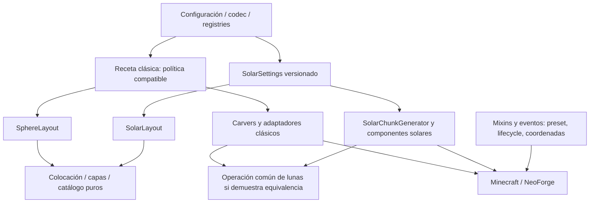
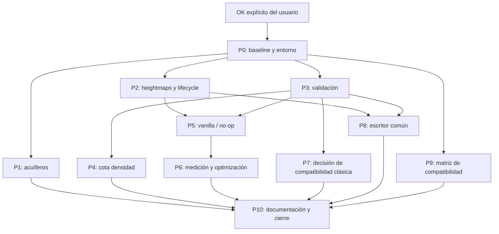

# Plan incremental de refactorización de Biospheres

Fecha: 22 de octubre de 2026. Base: `0ed8eae`. Objetivo exclusivo: Minecraft 1.21.1, NeoForge 21.1.216, Java21.

**Implementación autorizada y realizada por fases; estado vigente en la sección 16.** Las secciones 1–15 conservan el diseño y los criterios de aceptación originales, que no deben confundirse con pruebas ya completadas. Los hallazgos y ubicaciones del commit base están en [AUDITORIA_ARQUITECTURA_BIOSPHERES.md](C:/Personal/NeoBiosphere/AUDITORIA_ARQUITECTURA_BIOSPHERES.md). La persistencia clásica requiere la decisión específica descrita en la sección 13; las pruebas manuales y con mods externos siguen pendientes.

## 1. Objetivos de la refactorización

1. Corregir retención de memoria, contratos de coordenadas y validación antes de mover código.
2. Hacer explícita la propiedad/ciclo de vida de cada receta de generación.
3. Conservar identidad e independencia del clásico y solar, reutilizando solo algoritmos equivalentes.
4. Garantizar que vanilla y funciones desactivadas no cambien por trabajo de refactorización.
5. Preservar mundos existentes, IDs, snapshots solares1–7, semillas, hashes y orden de operaciones significativo.
6. Convertir cada cambio en una unidad pequeña, verificable y reversible.

No son objetivos: reescribir el motor, crear un framework de generadores, migrar Minecraft/NeoForge, añadir cuerpos o mecánicas, ampliar TOML sin necesidad, cambiar `mod_version`, retirar compatibilidad histórica ni aprovechar la revisión para «mejorar» distribución o balance.

El radio1 solar, la política actual sin plataformas artificiales, los hashes clásicos y `Math.abs(Integer.MIN_VALUE)` quedan fuera de correcciones colaterales. Si se desea cambiar jugabilidad, debe formularse como tarea separada con su cambio de comportamiento esperado.

**Restricción adicional del usuario: conservar la corrección previa de satélites.** Se identificó en `1.21.1` el arreglo del techo `5f48474`/`7f08beb` y el usuario confirmó que se refería a ese bug. Ajusta altura sin cambiar tamaño, semilla, azimut ni distancia radial, manteniendo comprobaciones de volumen y colisión. La implementación conserva `SatellitePlacement` intacto y activa `fitHeight=true` en el layout clásico, como aquella rama; solar mantiene el ajuste exclusivamente desde la versión 7. Un test reproduce el radio clásico 415 y comprueba la recuperación de la luna y la conservación de sus demás parámetros; otro caso sigue rechazando una luna que no cabe horizontalmente.

## 2. Arquitectura actual frente a propuesta

| Área | Actual | Propuesta mínima | Necesidad |
|---|---|---|---|
| Identificación clásica | Flags en varios objetos y set fuerte de acuíferos | Estado ligado al objeto/propietario, con transferencia/restauración explícita | PERF-001, COMP-001 |
| Layout clásico | Algoritmo centralizado + lectura global viva | Mantener algoritmo; separar obtención coherente de parámetros y, después, decidir snapshot por mundo | ARCH-001 |
| Solar | Snapshot versionado + `BoundWorld` | Conservar composición y versiones | Base correcta |
| Heightmaps | Rutas clásicas y solares con coordenadas distintas | Coordenadas de mundo normalizadas al entrar, políticas separadas | GEN-001 |
| Catálogo mineral | Algoritmo puro + resolver/evento/política clásica juntos | Validación común, políticas explícitas por consumidor y publicación válida | CFG-001 |
| Materiales/radios | Esquema general permisivo | Validación del dominio real antes de generar | CFG-002/003 |
| Satélites | Colocación/capas compartidas, escritura duplicada | Una operación común solo para la parte equivalente de escritura | DUP-001 |
| Densidad | Transformación común + cota clásica incorrecta | Mantener cálculo y declarar cota válida | API-001 |
| Integración | Mixins/eventos funcionales, cobertura parcial | Pruebas de contratos/lifecycle y gates explícitos | TEST-001, COMP-002/003 |



La «receta clásica» es una responsabilidad propuesta, **no el nombre de una clase nueva ya aprobada**. Puede resolverse primero con objetos existentes y captura local. La persistencia por mundo es una decisión posterior, no condición para corregir fugas o heightmaps.

## 3. Distribución recomendada de paquetes

Conservar inicialmente la distribución actual. Una reorganización masiva agrega conflictos y dificulta revisar igualdad funcional sin resolver los defectos prioritarios.

| Paquete existente bajo `mx.issacinzunza.biosphereworlds` | Responsabilidad recomendada | Cambio inmediato |
|---|---|---|
| `config` | Esquema TOML, validación de entrada, mapeo a datos | Validación; no ejecutar worldgen aquí |
| `worldgen` | Layout clásico y algoritmos comunes actuales | Aclarar qué métodos son puros y cuáles consultan entorno |
| `worldgen.solar` | Layout, snapshot, terreno, pintura y estructuras solares | Mantener cohesión actual |
| `carver` | Adaptación clásica que escribe chunks | Corregir solo contrato/escritura necesaria |
| `density` | Funciones y transformación de océano | Cotas correctas, no-op y traversal del hijo |
| `mixin` / `mixin.accessor` | Puentes mínimos al motor | Normalizar coordenadas, gates y lifecycle |
| `event` | Traducción de eventos a operaciones del dominio | No convertir el evento en propietario universal de datos |
| `registry` / `data` | Registro/bootstrap y recursos | Mantener IDs; revisar alcance de modificadores |
| `client` | Guía y presentación | Mantener aislamiento de carga cliente |
| `gametest` y árbol de tests | Integración de motor y algoritmos puros | Mantener fuera del jar distribuido |

Solo si una extracción concreta lo exige, considerar un pequeño archivo de datos compartidos en `worldgen` para desacoplar `SatellitePlacement` de records nominalmente clásicos. Un paquete `shared`, `core`, `services` o una interfaz genérica de cuerpo no aporta valor por su nombre. No crear los cuatro simultáneamente.

## 4. Responsabilidades de cada módulo

| Módulo | Debe hacer | Contrato que lo delimita |
|---|---|---|
| Configuración | Validar tipos, registros, rangos y relaciones; producir datos coherentes | No decidir materiales por bloque ni depender de orden de chunks |
| Layout clásico | Celda, centro, radio, satélites y consultas geométricas clásicas | `sphereAtCell` recibe índices; `sphereContaining` coordenadas de bloque; hash histórico intacto |
| Layout solar | Sistemas, órbitas, cuerpos, lunas y posiciones de jaulas versionadas | Seed+snapshot+versión; independiente de `SphereLayout.current()` |
| Núcleo satélite | Colocación determinista, estratos y selección ponderada | Parámetros explícitos; sin config/eventos/chunks; no reordenar identificadores |
| Resolución de minerales | Convertir IDs/tags a candidatos estables y diagnósticos | Snapshot inmutable; política de fallback del consumidor explícita |
| Carvers clásicos | Escribir solo en mundo clásico y región correspondiente | No crear nueva geometría paralela |
| Pintor solar | Aplicar recorte/materiales/liner/cascarón según versión | Reparaciones por etapa preservadas hasta medir y probar |
| Densidad | Transformar valores y exponer cotas correctas | `mapAll` recorre hijo; desactivado conserva bits |
| Estructuras solares | Placement central, contención, ajuste y permiso acotado | Portal funcional y compatibilidad de replacements verificados en motor |
| Eventos/mixins | Identificar propietario, traducir coordenadas, enganchar lifecycle | Vanilla retorna antes de cálculos/cachés específicos |
| Guardianes | Mecánica y balance solar | No convertir variación de juego en semilla de distribución |
| Cliente/red | Mostrar guía temporal con dimensión/estado válido | Sin incluir reglas visuales en geometría persistida |

## 5. Componentes reutilizables

| Componente real | Consumidores | Mantener / mejorar |
|---|---|---|
| `SatellitePlacement` | `SphereLayout`, `SolarLayout` | Conservar algoritmo; documentar adaptación de identidad solar y ajuste versión7 |
| `SatelliteLayers` | Carver clásico, pintor solar | Conservar fronteras/orden y selección determinista |
| `MineralCatalog` | Resolver común | Conservar orden estable y exclusiones; validar peso total antes de publicar |
| `SatelliteMineralCatalog.resolve` | Evento clásico, bind solar | No lee config internamente; evitar llamada si no hay consumidor habilitado |
| `SphereEdgeOcean` | Wrapper clásico, adaptador solar | Conservar aritmética y oráculo literal |
| Plantilla de ruido | Presets clásico y solar moderno | Conservar recurso; solar debe seguir creando estado propio |
| Búsqueda de `PlayerSpawnHandler` | Recuperación clásica y solar | Compartir búsqueda, no forzar idéntica política de activación |

No extraer una jerarquía común para strongholds, biomas, cuadrícula y órbitas: el parecido de nombres no demuestra un contrato sustitutable. No compartir directamente `SphereLayout.current` con solar para ahorrar un objeto. Reutilización correcta significa usar un algoritmo con datos propios.

## 6. Código duplicado que debería consolidarse

**Primera candidata: escritura de luna/satélite (DUP-001).** La consolidación solo se autoriza después de proteger cada ruta con un oráculo de bloques y heightmaps. Debe recibir límites/cuerpo/materiales ya resueltos y dejar fuera selección de preset, snapshot, órbitas y etapas de terreno.

Secuencia propuesta:

1. Caracterizar fronteras actuales, orden de cuadrados, cast y reglas de material de ambos escritores.
2. Identificar subconjunto realmente idéntico. Si la equivalencia solo abarca selección de material, compartir esa operación y conservar bucles distintos.
3. Introducir una operación pequeña en un propietario coherente; una clase nueva solo si mezclar escritura de Minecraft en una utilidad pura empeora el diseño.
4. Migrar un consumidor, ejecutar equivalencia y revisar diff.
5. Migrar el segundo; repetir matriz pertinente.
6. Retirar la copia de producción únicamente cuando ambas rutas estén cubiertas. Conservar oráculos de prueba independientes.

**Segunda candidata: validación de parámetros/catálogos.** Consolidar normalización duplicada de `SphereLayout.Params/current` sin cambiar clamps ni precedencia. La política de error clásico puede diferir de solar, aunque la condición matemática de validez sea común.

No consolidar ramas de layouts antiguos, `SphereEdgeOceanLiteral`, `SolarVolumeBaseline`, predicados clásico/solar de frontera ni algoritmos de estructura distintos. No sustituir tolerancias/arithmetic de tests por la producción para que «todo esté DRY».

## 7. Configuraciones que deberían externalizarse

**No se justifica añadir opciones nuevas como parte de esta auditoría.** La necesidad inmediata es que las existentes sean coherentes y válidas.

| Dato | Acción propuesta |
|---|---|
| Radios/spacing/centro/ancho de puente | Definir dominio técnico y relaciones; rechazar entradas inválidas con diagnóstico anticipado |
| `sphere_block`, `bridge_block` | Validación contra bloques e ID seguro; preservar lista vacía intencional |
| Inclusiones/exclusiones y pesos minerales | Validar resolución y total; elegir política de error explícita |
| Nivel del mar/límites de altura | Documentar relación con noise settings; derivar del contexto solo con equivalencia demostrada |
| Pesos vanilla, tiempos/límites de guardianes, biomas extremos | Conservar defaults de diseño hasta que exista requisito de balance/extensión |
| Hashes, sales, orden de órbitas, versiones | Nunca convertir en opciones ad hoc de esta refactorización |
| Defaults legacy y campos usados por snapshots antiguos | Preservar literalmente; no sustituir por defaults actuales |

Si más adelante se aprueba una opción, actualizar conjuntamente `SphereConfig`, idiomas `en_us/es_es/es_mx`, README y `docs/es/ARQUITECTURA.md`; validar min ≤ max donde corresponda. Una nueva opción que afecta generación solar requiere decidir si pertenece al snapshot y cómo se interpreta en versiones antiguas.

## 8. Refactorizaciones ordenadas por prioridad

| Tarea | Hallazgos | Cambio propuesto | Riesgo / esfuerzo |
|---|---|---|---|
| P0. Base reproducible | TEST-001 | Resolver ejecución de Gradle dentro de permisos y capturar baseline | Bajo / medio |
| P0b. Corrección clásica protegida | COMP-005 | Comparar con `1.21.1` y preservar arreglo del techo como requisito de integración | Medio / bajo–medio |
| P1. Identidad de acuífero | PERF-001 | Sustituir set fuerte por estado del objeto/NoiseChunk ya asociado | Medio / bajo–medio |
| P2. Heightmap clásico | GEN-001, COMP-001 | Coordenadas mundiales y lifecycle en update/prime/downward/promoción/carga | Medio / medio |
| P3. Entradas válidas | CFG-001..003 | Catálogo, radios/relaciones y materiales antes de generar | Medio–alto / medio |
| P4. Contrato DF | API-001 | Cota correcta sin cambiar `compute` ni saturar valores | Medio / bajo–medio |
| P5. Aislamiento vanilla | COMP-002, TEST-001 | Gating efectivo de features/resolución y pruebas de no-op | Medio / medio |
| P6. Trabajo innecesario | PERF-002/003 | Primero logging/lookup; luego optimizaciones justificadas por perfil | Bajo–alto según cambio / medio |
| P7. Autoridad clásica | ARCH-001 | Diseñar y aprobar snapshot/lifecycle compatible antes de persistir | Alto / alto |
| P8. Consolidación | DUP-001, ARCH-002 | Operación mínima compartida y contrato de datos más claro | Medio–alto / medio |
| P9. Compatibilidad histórica/mods | COMP-003/004 | Reproducir, probar y corregir solo contrato necesario | Alto si requiere intercepción / medio |
| P10. Mantenimiento | MAINT-001/002, HARD-001 | Documentación vigente, comentarios y deprecación acotada | Bajo, salvo IDs / bajo–medio |

P7 no debe bloquear P1–P6: no hace falta migrar el formato clásico para arreglar coordenadas o memoria. P9 de verificación puede comenzar temprano; una corrección invasiva sigue esperando evidencia. P10 documental puede acompañar cada fase, sin empaquetar limpieza masiva con correcciones.

## 9. Dependencias entre tareas



El diagrama expresa requisitos técnicos, no autoriza agentes paralelos ni cambios simultáneos en archivos compartidos. Ejecutar primero una corrección acotada facilita atribuir cualquier diferencia. Una fase puede cerrarse con diagnóstico y decisión de no cambiar si la hipótesis de rendimiento/compatibilidad no se reproduce.

## 10. Archivos potencialmente afectados

Raíz Java de producción: **`C:\Personal\NeoBiosphere\src\main\java\mx\issacinzunza\biosphereworlds\`**. Las rutas abreviadas de la tabla se resuelven contra esa raíz. Es inventario de impacto posible, no autorización de edición actual.

| Fase | Archivos principales | Consumidores a revisar |
|---|---|---|
| P1 | [BiosphereWorldgen.java](C:/Personal/NeoBiosphere/src/main/java/mx/issacinzunza/biosphereworlds/worldgen/BiosphereWorldgen.java:7), `mixin/MixinNoiseBasedAquifer.java` | `mixin/MixinNoiseBasedChunkGenerator.java`, `mixin/MixinNoiseChunk.java`, acceso de NoiseChunk |
| P2 | [MixinHeightmap.java](C:/Personal/NeoBiosphere/src/main/java/mx/issacinzunza/biosphereworlds/mixin/MixinHeightmap.java:34), `mixin/MixinChunkAccess.java` | `worldgen/BiosphereChunkAccess.java`, hooks de promoción/carga, `event/SolarEvents.java` como referencia, no como política a copiar |
| P3 | [SphereConfig.java](C:/Personal/NeoBiosphere/src/main/java/mx/issacinzunza/biosphereworlds/config/SphereConfig.java:45), `event/SatelliteMineralCatalog.java`, `worldgen/SphereLayout.java` | `worldgen/SatelliteLayers.java`, `worldgen/MineralCatalog.java`, `config/SolarConfig.java`, ambos escritores |
| P4 | [MultipleSpheresDistanceFunction.java](C:/Personal/NeoBiosphere/src/main/java/mx/issacinzunza/biosphereworlds/density/MultipleSpheresDistanceFunction.java:26) | Tests de rango y composición dentro del motor |
| P5 | `data/SphereBiomeBoostrap.java`, modificadores/feature correspondiente, `event/SatelliteMineralCatalog.java` | Recursos generados y registros, tests de mundo vanilla/vacío |
| P6 | `mixin/MixinMultiNoiseBiomeSource.java`, `carver/SphereCarver.java` | `event/PlayerSpawnHandler.java`, `worldgen/solar/SolarVolumePainter.java` solo si perfil lo justifica |
| P7 | `worldgen/SphereLayout.java`, config y adaptadores clásicos | Codecs/carvers/densidad/biomas/heightmaps; alcance final depende de diseño aprobado |
| P8 | `carver/SphereCarver.java`, `worldgen/solar/SolarVolumePainter.java` | `worldgen/SatellitePlacement.java`, `worldgen/solar/SolarLayout.java` solo si cambian contratos de datos |
| P9 | `worldgen/BiosphereBiomeSource.java`, `worldgen/solar/SolarStronghold.java` y mixins relacionados | Codecs guardados, TerraBlender/C2ME/replacements reales |
| P10 | [README.md](C:/Personal/NeoBiosphere/README.md), [ARQUITECTURA.md](C:/Personal/NeoBiosphere/docs/es/ARQUITECTURA.md) y Javadocs puntuales | Helpers internos solo tras búsqueda de consumidores |

Pruebas potencialmente afectadas: `C:\Personal\NeoBiosphere\src\test\java\mx\issacinzunza\biosphereworlds\` y [SolarWorldgenGameTests.java](C:/Personal/NeoBiosphere/src/main/java/mx/issacinzunza/biosphereworlds/gametest/SolarWorldgenGameTests.java). Preferir ampliar el test apropiado; no introducir clases de prueba que solo reflejen la implementación.

`biospheres.json`, `gradle.properties`, `build.gradle`, versiones y dependencias permanecen fuera de cambios implícitos. Si una fase exige modificar alguno, debe explicitarse y autorizarse antes; este plan no los incluye como limpieza rutinaria.

## 11. Riesgos sobre el generador clásico

| Riesgo | Por qué importa | Control |
|---|---|---|
| Cambiar hash/radio o arreglar MIN_VALUE | Redistribuye cuerpos históricos | Vectores de entrada/salida exactos y restricción explícita |
| Confundir celda con bloque | Cambia centro y satélites | Métodos con semántica inequívoca; no sobrecargas int/double ambiguas |
| Cambiar `<` por `<=` o normalizar radio efectivo negativo | Cambia voxels de frontera | Oráculo literal y casos de margen/radio extremos |
| Activar campos del codec antes ignorados | Reinterpreta mundos sin nueva configuración | Decisión P7 separada; no migración implícita |
| Corregir heightmap | Puede cambiar decoración/actualización de columnas respecto al defecto anterior | Delimitar cambio esperado a mapas artificiales, no regenerar terreno existente |
| Marca disponible demasiado tarde | Acuífero vuelve a generar fluidos fuera | Test de primera llamada y construcción real |
| Rechazar config antigua | Impide abrir mundo previamente tolerado | Validar con diagnóstico; elegir política sin sobrescribir TOML ni mundo silenciosamente |
| Saltar carvers vecinos | Puede cambiar semilla/orden al modificar recorrido | Probar ambos carvers, datapack sin uno y comparación exacta |
| Cambiar catálogo durante generación | Luna cruzada por chunks puede cambiar material | Política de snapshot/recarga explícita y test de frontera |

No prometer bit a bit entre una ruta defectuosa y su corrección deliberada. Exigir equivalencia en **todo lo que no esté incluido en el cambio aprobado** y enumerar qué diferencias se esperan. En funciones apagadas, el resultado debe ser no-op exacto, comparado con copia literal del comportamiento previo.

## 12. Riesgos sobre el generador solar

| Riesgo | Control propuesto |
|---|---|
| Reinterpretar versiones1–7 con defaults nuevos | Fixtures por versión, campos opcionales ausentes y roundtrip codec |
| Cambiar envelope al apagar lunas | Planetas/centros/IDs deben conservarse; no recalcular spacing más pequeño |
| Variar identidad al extraer records compartidos | Comparar mezcla de ID alto/bajo, seeds, orden y azimut |
| Alterar aritmética del escritor | Bloques y heightmaps exactos en límites y techo, no solo volumen continuo |
| Mutar template/RandomState clásico al optimizar | Dos generadores en mismo proceso, asserts de identidad/resultado independiente |
| Cambiar repintado posterior a decoración | Features pueden abrir cascarón o contaminar heightmaps; pruebas por etapa |
| Desplazar stronghold o junctions incorrectamente | Contención de todas las piezas y portal físico, también reemplazos |
| Compartir estado estático vanilla concurrente | Prueba con motor/mods; no suponer que el lock solar cubre llamadores externos |
| Congelar tags como si fueran persistidos | Documentar dependencia de modpack/tags; snapshot actual almacena reglas, no todos los bloques resueltos |
| Cambiar spawn/guardianes para «simplificar» | Mantener orden/destino, límites y comportamiento de versiones anteriores |

La guía es visual/runtime y no debe modificar geometría ni quedar persistida por accidente con un nuevo snapshot. Conservar aislamiento cliente y probar servidor dedicado después de cualquier cambio de callback/registro.

## 13. Estrategia para conservar mundos existentes

### Contratos que deben permanecer estables

- IDs de mod, registries, codecs, tipos de biome source, carvers, feature y placement.
- Campos serializados y defaults de ausencia de `SolarSettings`; versión ausente sigue significando el layout histórico correspondiente, no versión7.
- Hashes, sales, orden de consumo de aleatoriedad, orden de minerales, geometría y límites por versión.
- Separación de TOML clásico/solar y snapshot solar de generación frente a opciones runtime.
- Semántica de flags desactivados y comportamiento de las dimensiones del preset. No cambiar el End clásico para «normalizar» diferencias históricas.

### Política específica para ARCH-001

Antes de implementar persistencia clásica se necesita elegir y documentar el contrato. Hay dos pasos distintos:

1. **Estabilizar lectura en una operación:** capturar una instancia coherente de `SphereLayout`/parámetros y reutilizarla durante esa operación, conservando la política actual entre operaciones. Es acotado y no redefine necesariamente el formato guardado.
2. **Fijar receta por mundo:** exige decidir de dónde sale el primer snapshot de una partida clásica antigua y qué sucede si cambia TOML después. Tomar valores del codec hoy ignorados puede cambiar el mundo; capturar TOML al abrir puede ser compatible con una sesión, pero no recupera una receta histórica que no se guardó.

La recomendación es mantener una ruta legacy explícita hasta disponer de un diseño aprobado y fixtures de partidas. No escribir una migración silenciosa ni prometer reconstruir parámetros históricos que no existen en el guardado. Los mundos existentes se prueban mediante copias autorizadas; la auditoría no creó ni modificó esas copias.

**Diseño concreto propuesto para una fase posterior (no implementado):**

- Autoridad por dimensión clásica mediante un dato persistido propio, con `schema_version` y una receta inmutable; ausencia del dato significa la ruta global legacy, nunca «usar defaults nuevos». No activar los campos históricos de codec hoy ignorados.
- Capturar una sola vez, al crear explícitamente un mundo con esta modalidad, la geometría principal, puentes, materiales, bedrock, océano, satélites y restricciones de estructuras. Mantener fuera los ajustes de diagnóstico. La receta debe pasar por la misma validación antes de publicarse.
- Persistir también la selección mineral resuelta y sus pesos/densidades para que una recarga de tags no redistribuya minerales silenciosamente. Un bloque ausente debe producir un diagnóstico; no sustituirlo automáticamente por otro mineral.
- Vincular esa instantánea al generador/dimensión antes de crear biomas o ruido y pasarla a carvers, funciones de densidad, heightmaps y búsquedas. La lectura global sigue disponible exclusivamente para mundos legacy. Este cableado requiere diseño adicional: no basta con añadir un archivo guardado ni con cachear `SphereLayout.current()`.
- No migrar partidas antiguas al abrirlas. Una migración futura, solicitada expresamente sobre una copia, solo puede fijar la configuración que el usuario confirme; no reconstruye la receta pasada ni elimina fronteras entre chunks ya distintos.
- Aceptación: dos mundos con recetas diferentes en el mismo proceso, reinicio sin TOML original, tags cambiados, bloque faltante, versión desconocida rechazada y equivalencia legacy. Ninguna de estas garantías de persistencia se atribuye a los cambios actuales.

Esta propuesta añade formato y ciclo de vida y excede una corrección acotada. Se recomienda conservar ahora la ruta legacy y evaluar esa fase separadamente; no se añadieron opciones, codecs ni datos guardados para anticiparla.

### Despliegue y reversión de cada fase futura

Revisar diff pequeño y cambios esperados, probar en directorio descartable dentro del proyecto y después validar copias de mundos con autorización. Nunca usar `gradlew clean` ni borrar `run` para forzar una prueba. No añadir commit/push automáticamente. Si una fase altera datos persistidos, la reversión requiere evaluar esos datos, no solo deshacer Java; por eso P7 se separa del resto.

No eliminar codec histórico solo porque no lo emiten presets nuevos. Tampoco eliminar campos climáticos/guardianes antiguos que siguen siendo autoridad para snapshots previos.

## 14. Pruebas de regresión

### Matriz mínima de datos

| Eje | Casos |
|---|---|
| Generador | Vanilla normal, vanilla con `the_void` y superficie, clásico, solar |
| Semilla | 0, −1, `Long.MIN_VALUE`, semillas de fixtures existentes, una semilla con caso de luna ajustada en v7 |
| Coordenadas | Origen y chunks lejanos positivos/negativos, bordes de celda/chunk y límites verticales |
| Opciones | Todo opcional apagado; océano/satélites/liner/cierre/puentes individualmente; combinaciones pertinentes |
| Config | Defaults, radios variables, min=max, min>max, cero/negativo, límites admitidos y overflow rechazado |
| Material | Vidrio, bloque válido alternativo, lista vacía permitida, ítem sin bloque, ID inválido, mineral con peso0 |
| Versiones solares |1–7, campos ausentes, snapshots explícitos, versión desconocida rechazada |
| Lifecycle | Nueva generación, promoción a LevelChunk, carga, descarga, reapertura y recarga de tags |
| Orden | Secuencial, inverso, mezclado y varios hilos para algoritmos puros; motor paralelo real por separado |

No hace falta el producto cartesiano completo: seleccionar combinaciones que ejerciten cada rama y pares de interacción relevantes, con fixtures reproducibles. No afirmar cobertura estadística de todo el mundo por recorrer unas pocas celdas.

### Pruebas automatizadas propuestas

| Grupo | Qué debe ejecutar realmente | Criterio |
|---|---|---|
| Geometría | Métodos reales de layout/placement con oráculo literal independiente | Igualdad de centros/radios/IDs/posiciones; desactivado exacto |
| Catálogo | Resolución/validación pura y publicación mediante evento en motor | Nunca publicar distribución inválida; exclusiones y fallback según política aprobada |
| Heightmap clásico | Chunk real, materiales de satélite, update/prime/downward | Altura del terreno, no luna; coordenadas fuera del origen y negativas |
| Lifecycle | ProtoChunk→LevelChunk y carga desde guardado de prueba | Política restaurada antes de actualizar mapas; vanilla intacto |
| Acuífero | Primera llamada y generación real | Mismos fluidos, ausencia de raíz estática que retenga chunks descargados |
| Densidad | Función real y composición MIN/MAX | `compute` dentro de cotas; transformación no alterada |
| Escritor compartido | Ambas rutas de producción, antes/después | Todos los bloques y mapas idénticos fuera de defectos aprobados; incluir v3/v7 |
| Portales/estructuras | Ruta real de `StructureStart` y replacements | Permiso scoped, portal interior, piezas/junctions correctos |
| Vanilla | Generación completa con/sin mod o baseline reproducible | Bloques, biomas, heightmaps y estructura pertinente sin diferencias |
| Disabled | Consumidor real además de tabla de gate | No cálculo/resolución/caché específica innecesaria y salida bit a bit |

Mantener algoritmos puros en JUnit. El cableado NeoForge va en GameTests o pruebas manuales; no intentar arrancar NeoForge desde JUnit. Las pruebas de réplicas pueden seguir siendo oráculos, pero la otra mitad debe ser producción real o integración con el motor.

### Rendimiento y memoria

Para PERF-001, usar número de acuíferos vivos tras descargar/generar y retención desde raíces, no solo heap total. Un heap creciente durante generación activa no demuestra fuga por sí solo; la raíz estática identificada sí justifica la corrección.

Para PERF-002/003, fijar seed, región, configuración, versión de JVM/mods y condiciones de carga; separar calentamiento, ruido, superficie, carvers, decoración y recuperación de spawn. Registrar varias repeticiones y dispersión. El objetivo es quitar trabajo innecesario con resultado idéntico; no se promete mejora porcentual sin baseline.

### Validación manual dentro de Minecraft

1. Generar clásico con satélites sobre aldeas/vegetación; revisar calles y columnas antes/después de recarga.
2. Crear solar nuevo y cargar snapshots antiguos; revisar lunas al techo, cascarón/liner y fronteras entre chunks.
3. Verificar spawn inicial, login, respawn, caída al vacío y retorno desde el End, incluyendo radios pequeños sin soporte.
4. Localizar stronghold, recorrerlo, activar portal y viajar al End; repetir con replacement compatible.
5. Probar jaulas con dos jugadores separados, muertes lejanas, unload/reload, dificultad y gamerules.
6. Probar guía al cambiar dimensión/reconectar y servidor dedicado sin clases cliente cargadas indebidamente.
7. Comparar vanilla y ejecutar matriz de TerraBlender/C2ME con las versiones efectivamente usadas.

Durante el diagnóstico las pruebas no pudieron ejecutarse por el lock externo del wrapper. En la implementación se autorizó la ejecución normal de Gradle con su caché existente, sin cambiar scripts de build ni permisos. Los resultados posteriores figuran en la sección 16; no convierten la matriz manual anterior en pruebas realizadas.

## 15. Criterios de aceptación por fase

| Fase | Aceptación técnica | Evidencia a entregar |
|---|---|---|
| A: baseline | Herramientas ejecutables; árbol del usuario preservado; fixtures definidos | Comandos/resultados reales y limitaciones, sin inventar pases |
| B: memoria | Sin conjunto global fuerte; marca correcta en primera llamada | Test de integración + inspección de retención + comparación de fluidos |
| C: heightmaps | Coordenadas globales correctas, tres rutas y lifecycle cubiertos | GameTests clásicos, solar/vanilla sin regresión y prueba jugable de aldeas |
| D: validación/cotas | Entradas inválidas fallan antes de worldgen; datos válidos conservados | Matriz de configuración/materiales/pesos y función DF real |
| E: aislamiento | Vanilla sin efectos y opciones apagadas sin operación específica | Comparación de bloques/biomas/mapas y contadores de llamadas pertinentes |
| F: rendimiento | Beneficio medido sin diferencia funcional | Perfil reproducible, tiempos repetidos y equivalencia |
| G: receta clásica | Política de compatibilidad aprobada; ningún mundo reinterpretado silenciosamente | Documento de formato/lifecycle y fixtures de partidas antiguas |
| H: consolidación | Dos consumidores reales usan la operación común y conservan resultados | Diff acotado, pruebas exactas y oráculos independientes |
| I: compatibilidad/cierre | Resultados por mod/versión, docs coherentes y limitaciones declaradas | Matriz real, revisión de IDs/defaults y pruebas manuales del usuario |

Si una fase no cumple aceptación, detener esa fase y explicar la evidencia. No compensar un test fallido relajando igualdad a tolerancias arbitrarias. Una corrección deliberada de defecto debe tener expectativa nueva específica y dejar el resto del baseline intacto.

## 16. Plan incremental de implementación

**Estado actual: correcciones implementadas, build y pruebas automatizadas aprobados, documentación actualizada.** No se considera terminada toda la matriz de aceptación manual ni la propuesta de persistencia.

| Prioridad / hallazgos | Resultado implementado | Límite pendiente |
|---|---|---|
| P0 / P0b, COMP-005 | Build con Java 21; ajuste clásico al techo recuperado y protegido con regresión; solar 1–7 conservado | Comprobación visual en esferas grandes |
| P1, PERF-001 | Eliminado el conjunto estático fuerte de acuíferos; cada acuífero consulta la marca de su NoiseChunk | No hay heap dump ni medición de memoria liberada |
| P2, GEN-001 / COMP-001 | Coordenadas mundiales en update/prime/downward; LevelChunk consulta el generador de su mundo | Falta prueba jugable de aldeas y reapertura positiva de mundo clásico; el test de promoción cubre vanilla con marca obsoleta |
| P3, CFG-001/002/003 | Registro de bloques, enteros/rangos, min <= max y catálogo con peso positivo; resolución clásica diferida e inmutable, sin restaurar exclusiones | Valores individuales inválidos siguen la corrección estándar de NeoForge; el par incoherente y catálogo inválido fallan antes de generar bloques |
| P4, API-001 | Cota superior infinita correcta para el dominio del contexto; composición MAX probada con la función real | Se conserva expresamente el caso histórico del hash MIN_VALUE |
| P5, COMP-002 | Nieve propia limitada a ambos presets; gate en feature histórica; catálogo no resuelto con satélites apagados o cantidad cero | No hay comparación completa de un mundo vanilla con/sin mod |
| P6, PERF-002/003 | Evitado muestreo redundante de bioma, conteo de minerales sin DEBUG y preparación de puentes apagados | Sin perfil ni porcentaje de mejora; spawn, pasadas del pintor y recorrido de carvers conservados |
| P7, ARCH-001 | Diseño concreto en sección 13 | Sin implementación ni migración de persistencia; el clásico sigue usando configuración global |
| P8, DUP-001 / ARCH-002 | SatelliteMaterials comparte exclusivamente selección de bloques; ambos escritores preservan aritmética, recorridos y oráculos literales | No se elimina todo el acoplamiento de tipos entre layouts |
| P9, COMP-004 | Wrapper histórico conserva codec e incluye void; búsqueda heredada continúa tras candidatos exteriores | COMP-003: C2ME, TerraBlender, strongholds y concurrencia externa requieren matriz real |
| P10, MAINT-001/002 / TEST-001 | Documentación sincronizada, IDs históricos conservados y cobertura de integración ampliada | No se eliminan registros antiguos ni se declara completa la cobertura de jugabilidad |

Dos clases productivas nuevas tienen una finalidad concreta: `SphereSnowFeature` permite comprobar el generador antes de ejecutar nieve; `SatelliteMaterials` evita mantener dos selecciones de materiales distintas sin unificar geometrías. No se introdujo un framework ni se reorganizaron paquetes.

### Verificación realizada el 22 de octubre de 2026

- **Build exitoso**, Java 21.0.6 / Minecraft 1.21.1 / NeoForge 21.1.216. Resultado final en [work/audit-validation.log](C:/Personal/NeoBiosphere/work/audit-validation.log): `BUILD SUCCESSFUL`.
- **109/109 JUnit**, cero fallos y cero omitidos. Incluyen el caso clásico de satélite alrededor de radio 415, selección mineral válida y rangos de configuración; permanecen los oráculos anteriores de geometría/hash/rutas desactivadas.
- **29/29 GameTests requeridos**, incluyendo nueve contratos clásicos/integración nuevos: marca de acuífero tras construcción, heightmaps fuera del origen en ambos signos, promoción vanilla con marca obsoleta, catálogo apagado/cantidad cero, escritor clásico contra materiales literales, codec/búsqueda histórica, gate de nieve, validación de materiales y composición de densidad.
- La comparación del pintor solar con `SolarVolumeBaseline` completó **336 casos**, cubriendo versiones **1–7** y comparando bloques/heightmaps de las fixtures. Sus tiempos son diagnósticos de esa ejecución, no un benchmark ni una mejora porcentual acreditada.
- **17 JSON válidos**, idiomas `en_us`, `es_es`, `es_mx` con las mismas **89 claves**; `git diff --check` sin incidencias.
- Sin cambios en `mod_version`, scripts de build, `biospheres.json`, `SatellitePlacement`, `SolarSettings` ni oráculos literales existentes; sin commit/push. Se conservaron IDs históricos y se añadió únicamente el registro necesario de nieve propia.

Comando ejecutado desde la raíz, con la caché de Gradle existente autorizada:

```powershell
$env:JAVA_HOME='C:\Program Files\Java\jdk-21'
.\gradlew.bat build runGameTestServer --offline --no-daemon --no-configuration-cache --console=plain --init-script work/audit-verification.gradle
```

El init script local [work/audit-verification.gradle](C:/Personal/NeoBiosphere/work/audit-verification.gradle) redirige `gameTestServer` a `work/audit-gametest-20261022`, creado para esta auditoría, y muestra el total JUnit. `work/` está ignorado por Git; estos auxiliares y registros no son cambios productivos. No se usaron partidas del usuario ni `run/` para estas pruebas.

Durante el desarrollo del último test se corrigieron una llamada al gestor de estructuras equivocado y una espera bloqueante del test. La traza confirmó que el worker necesitaba tareas del servidor; la prueba ahora usa `managedBlock` antes de `join`. La suite completa se repitió después y pasó. No se relajaron aserciones para obtener el resultado.

Contratos Minecraft contrastados en **MC-S**, el ZIP de fuentes identificado en la auditoría: `ServerLevel.java:329` (`structureManager`), `NoiseBasedChunkGenerator.java:77` (`createBiomes` asíncrono), `BlockableEventLoop.java:130` (`managedBlock`), `ChunkAccess.java:559` (`getLevel`) y `BiomeSource.java:109` (búsqueda por candidatos). No se atribuyen a JUnit pruebas de arranque de NeoForge.

**Pendientes explícitos:** heap/perfil, comparación de mundos vanilla completos, reapertura clásica positiva, inspección jugable de aldeas/satélites/portales, multijugador y mods externos. P7 conserva solo diseño. Las validaciones automatizadas anteriores no sustituyen esos criterios.

**Secuencia original de referencia, con el estado actual indicado arriba:**

1. Acordar el primer alcance: se recomienda P1 (retención de acuíferos), sin mezclar persistencia ni consolidación. Resolver antes la ejecución de verificación respetando permisos y directorios.
2. Preparar una prueba que observe la marca a tiempo y un baseline de fluidos. Aplicar el cambio mínimo de propietario/consulta. Ejecutar comprobaciones y reportar memoria/resultado con sus límites.
3. Abordar P2 de forma separada: reproducir coordenadas locales, corregir conversión y filtrado; después cubrir promoción/carga. Revisar calles/vegetación en juego antes de declarar cerrado el defecto visual.
4. Corregir P3 por unidades: materiales, dominio numérico y catálogo. Resolver explícitamente el comportamiento de configuración antigua inválida y exclusiones totales; actualizar documentación pertinente sin cambiar defaults válidos.
5. Ajustar P4 y verificar contrato de densidad; no tocar plantilla JSON ni algoritmos de radio.
6. Cerrar P5 de vanilla y disabled. Revisar feature de nieve y catálogo sin introducir un gate global que se evalúe antes de que exista mundo y quede cacheado erróneamente.
7. Medir P6; aplicar solo las optimizaciones justificadas. La búsqueda de spawn y las pasadas del pintor pueden permanecer sin cambio si no se obtiene evidencia suficiente para preservar semántica y mejorar costo.
8. Presentar diseño concreto de P7 para aprobación antes de alterar persistencia. No bloquear por él las correcciones anteriores ni inventar un snapshot histórico.
9. Con cobertura suficiente, ejecutar P8 con un consumidor por paso. Evitar reorganización de paquetes simultánea; conservar hash, operaciones flotantes y versiones.
10. Completar matriz P9 y actualización P10. Entregar cambios, motivos, pruebas reales y riesgos pendientes, sin commit/push ni modificación de versión no solicitados.

Cada paso vuelve al usuario con una unidad comprobable y los resultados, según la regla de dos fases del proyecto. La aprobación de una corrección acotada no autoriza por extensión una migración de partidas o reescritura de arquitectura.

La estrategia recomendada es **corregir contratos y ciclo de vida, demostrar equivalencia y consolidar solo la duplicación que queda**. La estructura actual permite hacerlo sin sacrificar la identidad de ninguno de los dos generadores.
